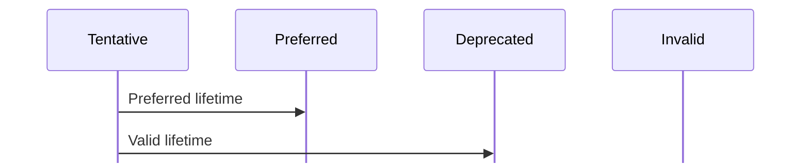

RouterOS 透過使用 Router Advertisement Daemon (RADVD) 支援 IPv6 鄰居發現和無狀態地址自動配置。

## 標準 {#standards}

- [`RFC 4861`](https://tools.ietf.org/html/rfc4861) - IPv6 的鄰居發現。
- [`RFC 4862`](https://tools.ietf.org/html/rfc4862) - IPv6 無狀態地址自動配置

## 節點描述 {#node-description}

節點是實現 IPv6 的裝置。在 IPv6 網路中，節點分為兩種型別：

- **路由器** - 轉發並非明確發往自身的 IPv6 封包的節點。
- **主機** - 任何不是路由器的節點。

路由器和主機是 RFC 4861 中定義的不同分類，但單個裝置可以同時承擔這兩種角色：轉發封包（路由器）以及接收發往自身的流量（主機）。

## 無狀態地址自動配置 {#stateless-address-autoconfiguration}

自動配置有幾種型別：

- *無狀態* - 地址配置透過接收 Router Advertisement 訊息完成。這些訊息包含無狀態地址字首，並要求主機未使用有狀態地址配置協定。
- *有狀態* - 地址配置透過使用有狀態地址配置協定（DHCPv6）完成。如果 RA 訊息不包含地址字首，則使用有狀態協定。
- *兩者* - RA 訊息包含無狀態地址字首，並要求主機使用有狀態地址配置協定。

IPv6 可以在不使用 DHCP 等有狀態配置協定的情況下自動配置自身（[示例](#stateless-autoconfiguration-example)）。

:::info
地址自動配置只能在支援多播的介面上執行。
:::

此過程稱為無狀態地址自動配置，因為路由器不管理狀態。它是一種簡單、穩健且有效的方法。

RouterOS 使用 RADVD 定期向同一鏈路上的所有節點通告有關該鏈路的資訊。該資訊由 ICMPv6“路由器通告”封包承載，幷包括以下欄位：

- IPv6 子網字首。
- 預設路由器的鏈路本地地址。
- 其他可能為可選的引數包括：鏈路 MTU、預設跳數限制和路由器生存時間。

主機使用該通告來配置全域性 IPv6 地址和預設路由器。全域性 IPv6 地址由通告的[子網字首](./ipv6-addresses.md)和 EUI-64 [介面識別符號](./ipv6-addresses.md#interface-identifier)生成。

你可以透過傳送 ICMPv6 路由器請求封包來請求通告。在 Linux 上，**rtsol** 實用程式會發送路由器請求。移動節點應定期傳送路由器請求。

### 地址狀態 {#address-states}

當分配自動配置地址時，該地址可能處於以下狀態之一：

- ***`tentative`*** - 在此狀態下，主機會驗證該地址是否唯一。驗證透過重複地址檢測進行。
- ***`preferred`*** - 在該狀態下，地址已驗證為唯一，節點可以向首選地址傳送單播流量以及從首選地址接收單播流量。preferred 狀態的持續時間包含在 RA 訊息中。
- ***`deprecated`*** - 地址仍然有效，但不用於新連線。
- ***`invalid`*** - 節點不能再發送或接收單播流量。地址在有效生存時間到期後進入 invalid 狀態。

下圖說明了狀態與生存時間之間的關係：



## 鄰居發現 {#neighbor-discovery}

鄰居發現 (ND) 使用訊息和過程來確定相鄰節點之間的關係。與 IPv4 相比，ND 取代了 Address Resolution Protocol (ARP)、ICMP Router Discovery 和 ICMP Redirect，同時提供額外功能。

主機使用 ND 來：

- 發現相鄰路由器。
- 發現地址、地址字首和其他配置引數。

路由器使用 ND 來：

- 通告自身的存在、主機配置引數和鏈路上字首。
- 告知主機針對特定目標的更優下一跳地址。

節點使用 ND 來：

- 解析正在轉發 IPv6 封包的相鄰節點的鏈路層地址，並確定該地址何時發生變化。
- 確定能否向鄰居傳送 IPv6 封包以及從鄰居接收 IPv6 封包。

RFC 4861 定義了五種 ND 訊息型別：路由器請求（RS）、路由器通告（RA）、鄰居請求（NS）、鄰居通告（NA）和重定向。將介面新增到 [`/ipv6/nd`](../../cli-reference/ipv6/nd/index.md) 只會啟用路由器側的訊息：

- 路由器請求（RS）——路由器監聽主機發送的 RS，並以路由器通告進行回覆。
- 路由器通告（RA）——路由器定期傳送未經請求的 RA，並對其收到的任何 RS 進行響應。RA 的內容（字首、標誌點陣圖、生存時間、MTU、計時器值）取自每個介面的 [`/ipv6/nd`](../../cli-reference/ipv6/nd/index.md) 設定以及任何 [`/ipv6/nd/prefix`](../../cli-reference/ipv6/nd/prefix/index.md) 條目。[`/ipv6/nd`](../../cli-reference/ipv6/nd/index.md) 列表具有介面選項 'all'，其優先順序低於為特定介面配置的條目。
- 鄰居請求（NS）——當路由器收到針對其在該介面上任何自身地址（鏈路本地、SLAAC 或靜態）的 NS 時，會以鄰居通告進行回覆。這也涵蓋對路由器自身地址的重複地址檢測（DAD）。
- 鄰居通告（NA）——響應 NS 時傳送（如上所述）。除非明確啟用，否則不會發送未經請求的 NA。

終端裝置之間的主機到主機 NS/NA 由主機協定棧自動處理，不受 [`/ipv6/nd`](../../cli-reference/ipv6/nd/index.md) 選單控制。重定向生成是可選的，預設停用（`redirect=no`）。

## 示例 {#examples}

#### 無狀態自動配置示例 {#stateless-autoconfiguration-example}

```ros
[admin@MikroTik] > ipv6 address print
Flags: X - disabled, I - invalid, D - dynamic, G - global, L - link-local
# ADDRESS INTERFACE ADVERTISE
0 G 2001:db8::1/64 ether1 yes

```

在此示例中，[`advertise`](../../cli-reference/ipv6/address.md#advertise_) 標誌已啟用，這表示已新增動態 [`/ipv6/nd/prefix`](../../cli-reference/ipv6/nd/prefix/index.md) 條目。

```ros
[admin@MikroTik] > /ipv6/nd/prefix/print
Flags: X - disabled, I - invalid, D - dynamic
0 D prefix=2001:db8::/64 interface=ether1 on-link=yes autonomous=yes
 valid-lifetime=4w2d preferred-lifetime=1w
```

在直接連線到路由器的主機上，我們看到已新增一個地址。該地址由字首部分（前 64 位）和主機部分（後 64 位）組成，字首部分從字首通告中獲取字首，主機部分根據本地 MAC 地址自動生成：

```ros
atis@atis-desktop:~$ ip -6 addr
 1: lo: <LOOPBACK,UP,LOWER_UP> mtu 16436
inet6 ::1/128 scope host
valid_lft forever preferred_lft forever
2: eth0: <BROADCAST,MULTICAST,UP,LOWER_UP> mtu 1500 qlen 1000
inet6 2001:db8::21a:4dff:fe56:1f4d/64 scope global dynamic
 valid_lft 2588363sec preferred_lft 601163sec
inet6 fe80::21a:4dff:fe56:1f4d/64 scope link
valid_lft forever preferred_lft forever
```

主機已從路由器收到 *2001:db8::/64* 字首，並使用該字首配置了一個地址。

你還可以使用 RADVD 重新分發 [DNS](../../network-management/dns.md) 伺服器資訊：

```ros
[admin@MikroTik] > /ipv6/nd/set [find where interface=all] dns=2001:db8::2 advertise-dns=yes
```

或者，你可以將路由器自身的 LL IPv6 地址作為 DNS 伺服器分發，並將路由器本身用作 DNS 快取：

```ros
[admin@MikroTik] > /ipv6/nd/set [find where interface=all] advertise-dns=self
```

如果你通告特定伺服器，則每個 RA 還會將路由器自身的 LL 地址作為 DNS 伺服器包含在內，但將其作為已過期的伺服器。如果此伺服器之前曾被使用過（如果你在 self 和 yes 選項之間更改了設定），則需要這樣做來使其失效。任何正確處理 RA DNS 的用戶端都會忽略此伺服器，或者如果現有伺服器就是路由器本身，則會使其失效。

你需要支援 Router Advertisement DNS 的用戶端軟體才能使用通告的 DNS 資訊。

在 Ubuntu/Debian Linux 發行版上，你可以安裝 **rdnssd** 軟體包，它能夠接收通告的 DNS 地址。

```ros
mrz@bumba:/$ sudo apt-get install rdnssd
```

```ros
mrz@bumba:/$ cat /etc/resolv.conf
# Dynamic resolv.conf(5) file for glibc resolver(3) generated by resolvconf(8)
 # DO NOT EDIT THIS FILE BY HAND -- YOUR CHANGES WILL BE OVERWRITTEN
 nameserver 2001:db8::2

mrz@bumba:/$ ping6 www.mikrotik.com
PING www.mikrotik.com(2a02:610:7501:1000::2) 56 data bytes
 64 bytes from 2a02:610:7501:1000::2: icmp_seq=1 ttl=61 time=2.11 ms
 64 bytes from 2a02:610:7501:1000::2: icmp_seq=2 ttl=61 time=1.33 ms
^C
 --- www.mikrotik.com ping statistics ---
2 packets transmitted, 2 received, 0% packet loss, time 1001ms
rtt min/avg/max/mdev = 1.334/1.725/2.117/0.393 ms
mrz@bumba:/$
```
