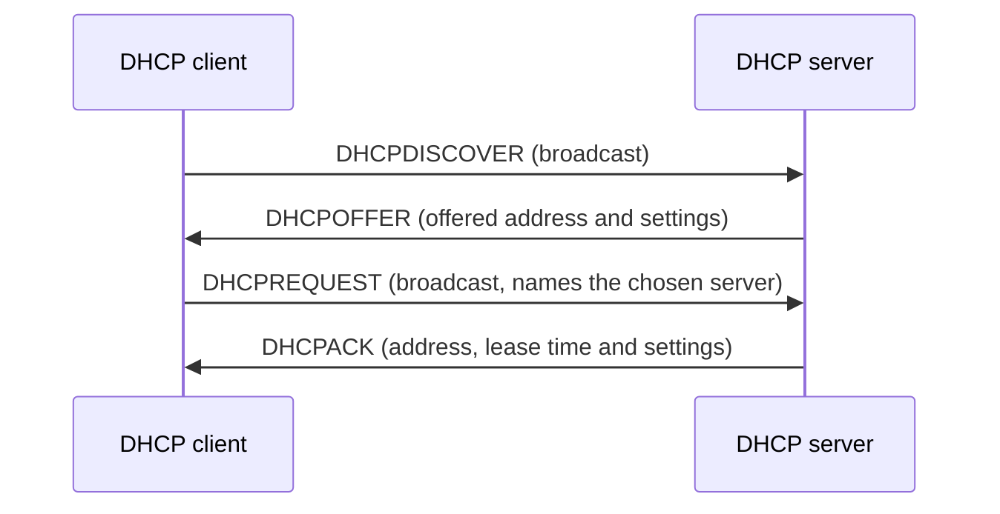

Dynamic Host Configuration Protocol（DHCP）會自動為主機分配 IP 地址和其他網路設定，因此無需手動配置。DHCP 伺服器管理一個地址範圍，並在有限時間內將它們連同子網掩碼、預設閘道器和 DNS 伺服器等設定一起租給用戶端。

RouterOS 按照 RFC 2131 實現 IPv4 的 DHCP，按照 RFC 8415 實現 DHCPv6，併為兩者分別提供用戶端、伺服器和中繼。

## RouterOS 元件 {#routeros-components}

| 元件 | 選單 | 用途 |
| :-- | :-- | :-- |
| [DHCP 用戶端](./client.md) | `/ip/dhcp-client` | 為介面獲取 IPv4 地址和網路設定，例如從 ISP 獲取。 |
| [DHCP 伺服器](./server.md) | `/ip/dhcp-server` | 為本地網路中的主機分配 IPv4 地址和網路設定。 |
| [DHCP 中繼](./relay.md) | `/ip/dhcp-relay`、`/ipv6/dhcp-relay` | 將用戶端請求轉發到另一個網路中的 DHCP 或 DHCPv6 伺服器。 |
| [DHCPv6 用戶端](./dhcpv6-client.md) | `/ipv6/dhcp-client` | 獲取 IPv6 地址或委派的 IPv6 字首，例如從 ISP 獲取。 |
| [DHCPv6 伺服器](./dhcpv6-server.md) | `/ipv6/dhcp-server` | 向用戶端委派 IPv6 字首或分配 IPv6 地址。 |

## 用戶端如何獲取地址 {#how-a-client-gets-an-address}

沒有 IP 地址的主機無法傳送或接收普通的單播 IP 流量，因此最初的 DHCP 訊息都是廣播。用戶端從 UDP 埠 68 傳送到伺服器監聽的埠 67。獲取地址需要四條訊息（RFC 2131 第 3.1 節）：

1. 用戶端廣播一條 DHCPDISCOVER 訊息，以查詢網路中的伺服器。
2. 每個能夠為該用戶端提供服務的伺服器都會回覆一條 DHCPOFFER 訊息，其中包含建議的 IP 地址和設定。
3. 用戶端選擇一個提議，並廣播一條 DHCPREQUEST 訊息，指明所選的伺服器。其他伺服器看到自己的提議未被接受，便將所提供的地址歸還到各自的地址池中。
4. 被選中的伺服器用 DHCPACK 訊息進行確認，用戶端隨即配置該地址。如果該地址已不可用，伺服器則改為回覆 DHCPNAK，用戶端重新開始。

在用戶端配置好其地址之前，伺服器要麼廣播自己的回覆，要麼將其作為單播發送到用戶端的 MAC 地址和建議的 IP 地址。無法接收此類單播回覆的用戶端會在其訊息中設定廣播標誌，隨後伺服器便會廣播其回覆（RFC 2131 第 4.1 節）。在 RouterOS 中，DHCP 用戶端的 `use-broadcast` 屬性控制此標誌，而 DHCP 伺服器的 `always-broadcast` 屬性會使伺服器無論該標誌如何都廣播其回覆。

### 地址衝突檢查 {#address-conflict-checks}

雙方都會在地址被使用之前檢查它是否空閒（RFC 2131 第 2.2 節）：

- 伺服器在提供某個地址之前，應探測該地址，例如傳送 ICMP echo 請求。當啟用 `conflict-detection`（預設啟用）時，RouterOS DHCP 伺服器會在提供地址之前，針對該地址傳送 ARP 請求和 ICMP echo 請求。如果有另一臺主機應答，伺服器會記錄一條警告，在租期內將該地址保留為狀態為 `conflict` 的租約，並從地址池中提供另一個空閒地址。當另一臺主機不再應答時，`check-status` 租約命令會釋放該地址。靜態租約的地址不會被探測，即使另一臺主機正在使用它們也會被分配出去。
- 用戶端在配置所收到的地址之前，應檢查該地址，例如使用 ARP。如果另一臺主機已在使用該地址，用戶端會發送 DHCPDECLINE 訊息並重新開始。RouterOS DHCP 伺服器會以 `declined` 狀態顯示用戶端拒絕的租約；這在正常操作中不會發生。

## 租約與續租 {#leases-and-renewal}

地址是租用的，而非永久分配的。伺服器會告知用戶端租約持續多長時間，用戶端必須在租約到期前續租才能保留該地址。RFC 2131（第 4.4.5 節）為此定義了兩個定時器，伺服器也可以顯式設定它們：

- **T1**，預設為租期的 50%：用戶端以單播方式向發放該租約的伺服器傳送 DHCPREQUEST 訊息（續租）。當伺服器確認後，租約即被延長。
- **T2**，預設為租期的 87.5%：如果伺服器沒有應答，用戶端會廣播 DHCPREQUEST 訊息，這樣任何伺服器都可以延長租約（重新繫結）。
- 當租約到期而未被延長時，用戶端會停止使用該地址，並以 DHCPDISCOVER 訊息重新開始。

例如，在 RouterOS DHCP 伺服器預設租期 30 分鐘的情況下，使用預設定時器的用戶端會在 15 分鐘後續租，並在 26 分 15 秒後開始重新繫結。RouterOS DHCP 用戶端的 `status` 屬性會顯示用戶端正處於這些階段中的哪一個。

不再需要其地址的用戶端可以透過 DHCPRELEASE 訊息提前歸還地址。RouterOS DHCP 用戶端的 `release` 命令可完成此操作。

## 用戶端標識 {#client-identification}

當用戶端續租，或在重啟後請求地址時，伺服器需要再次識別該用戶端。如果用戶端傳送了用戶端識別符號選項（選項 61），則以該選項標識用戶端；否則以硬體（MAC）地址標識（RFC 2131 第 4.2 節）。

預設情況下，RouterOS DHCP 伺服器使用這兩者來識別用戶端（`dynamic-lease-identifiers`），靜態租約可以繫結到 MAC 地址或用戶端識別符號。預設情況下，RouterOS DHCP 用戶端會發送基於其 MAC 地址的用戶端識別符號。它也可以改為傳送基於路由器 DHCP 唯一識別符號（DUID）的識別符號，如 RFC 4361 所述，這與 DHCPv6 用戶端使用的識別符號相同。

## 選項 {#options}

除 IP 地址本身之外，所有設定都承載在選項中，每個選項由一個編號標識（RFC 2132）。常用選項：

| 程式碼 | 選項 |
| --: | :-- |
| 1 | 子網掩碼 |
| 3 | 路由器（預設閘道器） |
| 6 | DNS 伺服器 |
| 12 | 主機名 |
| 15 | 域名 |
| 42 | NTP 伺服器 |
| 43 | 廠商特定資訊 |
| 51 | 租約時間 |
| 54 | 伺服器識別符號 |
| 55 | 引數請求列表 |
| 60 | 廠商類別識別符號 |
| 61 | 用戶端識別符號 |
| 82 | 中繼代理資訊 |
| 121 | 無類靜態路由 |

用戶端會在引數請求列表（選項 55）中列出它想要的選項，伺服器則用這些選項的值進行回覆。當伺服器傳送無類靜態路由（選項 121）時，用戶端會忽略路由器選項（選項 3），因此預設路由也必須包含在選項 121 中（RFC 3442）。RouterOS DHCP 用戶端預設遵循此規則；使用 `add-default-route=special-classless` 時，它會同時安裝無類路由和來自選項 3 的預設路由。

RouterOS DHCP 伺服器會發送匹配網路（`/ip/dhcp-server/network`）的設定，你還可以定義額外的自定義選項，參見 [DHCP 選項](./server.md#dhcp-options)。

## DHCP 中繼 {#dhcp-relay}

DHCP 廣播不會跨越路由器，因此 DHCP 伺服器只能聽到與其直接相連的網路中的用戶端。要為其他網路提供服務，需要在用戶端所在網路的路由器上執行 DHCP 中繼。中繼接收用戶端的廣播，並將其作為單播訊息轉發給一個或多個 DHCP 伺服器（RFC 2131 第 4.1 節）。

中繼會將其在用戶端網路上的地址寫入每條轉發訊息的閘道器地址欄位（`giaddr`），伺服器則把回覆傳送回該地址。中繼還可以新增中繼代理資訊選項（選項 82，RFC 3046），以告知伺服器該請求來自哪個埠或線路。

在 RouterOS 中，中繼會將其 `local-address` 寫入 `giaddr`；當未設定 `local-address` 時，則寫入其某個介面的地址。當其 `relay` 屬性與該地址匹配，或被設定為 `255.255.255.255` 以接受任何中繼時，DHCP 伺服器會應答中繼的請求，並從自己的地址池中分配地址。完整示例請參見 [DHCP 中繼](./relay.md)。

## DHCPv6 {#dhcpv6}

DHCPv6（RFC 8415）為 IPv6 提供相同的用途，但在幾個方面工作方式不同：

- 用戶端從其鏈路本地地址向 All_DHCP_Relay_Agents_and_Servers 組播地址 `ff02::1:2` 傳送訊息。用戶端使用 UDP 埠 546，伺服器使用埠 547。
- 用戶端透過 Solicit、Advertise、Request 和 Reply 訊息獲取配置。使用 Rapid Commit 時，Solicit 和 Reply 就足夠了。
- 每臺裝置都有一個 DHCP 唯一識別符號（DUID），用戶端的每個身份關聯都有一個身份關聯識別符號（IAID）。伺服器透過 DUID 和 IAID 來識別用戶端繫結，而不是透過 MAC 地址。
- 用戶端可以請求地址（IA_NA）和委派字首（IA_PD）。透過字首委派，路由器會收到一個完整的字首，例如來自 ISP 的 /56 或 /60，並用其為自己的網路編號。
- DHCPv6 不提供預設閘道器。主機透過路由器通告（RFC 4861）獲知預設路由器。路由器通告中的受管（M）和其他配置（O）標誌告訴主機是使用 DHCPv6 獲取地址，還是僅用於其他設定。在 RouterOS 中，這些標誌是 [`/ipv6/nd`](../../cli-reference/ipv6/nd/index.md) 的 `managed-address-configuration` 和 `other-configuration` 屬性。RouterOS DHCPv6 用戶端可以選擇使用 `add-default-route` 新增一條指向伺服器的預設路由。

關於不使用 DHCPv6 的地址自動配置，請參見 [IPv6 鄰居發現](../../getting-started/networking-fundamentals/ipv6-neighbor-discovery.md)。關於透過 PPPoE 進行字首委派，請參見 [PPP 上的 IPv6 PD](../../virtual-private-networks/pppoe/ipv6-pd-over-ppp.md)。
