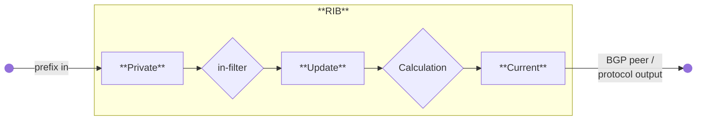

路由是在網路之間選擇路徑，將封包從一臺主機移動到另一臺主機的過程。路徑選擇也稱為路由決策，它依賴於路由資訊表。該表包含路由條目，每個條目指定一個目標以及到達該目標所使用的下一跳。當封包從一個網段傳遞到另一個網段時，就發生了一次*跳*。


通常，路由資訊分為兩部分，RouterOS 也不例外：

* **FIB** – 轉發資訊庫（Forwarding Information Base），用於做出封包轉發決策。它包含轉發所需的路由資訊子集。
* **RIB** – 路由資訊庫（Routing Information Base），包含從路由來源（如直連網路、靜態路由、BGP、RIP 和 OSPF）學習到的所有字首。


## 路由資訊庫 {#routing-information-base}

RIB 包含完整的路由資訊，包括靜態路由、直連網路，以及從動態協定和 MPLS 標籤繫結協定（如 OSPF、BGP 和 LDP）學習到的路由。  
RIB 不僅僅是儲存路由：它還會過濾路由資訊以計算每個目標字首的最佳路由，構建並更新 FIB，並在路由協定之間分發路由。

預設情況下，所有路由都組織在一個 **main** 路由表中。

### 直連網路 {#connected-networks}

直連路由表示主機可以直接到達的網路（直接連線到二層廣播域）。對於每個在 `/ip/address` 或 `/ipv6/address` 下配置了至少一個已啟用介面的 IP 網路，RouterOS 會自動建立一條直連路由。RIB 會跟蹤直連路由的狀態，但不會修改這些路由。每條直連路由都有一個對應的 IP 地址項，使得：

* 直連路由 `dst-address` 中的 **address** 部分等於 IP 地址項的網路。
* 直連路由 `dst-address` 中的 **netmask** 部分等於 IP 地址項地址的 netmask 部分。
* 直連路由的 **gateway** 等於 IP 地址項的 [`actual-interface`](../../cli-reference/ip/address.md#actual-interface)（與介面相同，但橋接介面埠除外），表示可以到達該特定三層網路中直連主機的介面。

直連網路示例：

```text
[admin@TempTest] /ip/route> print where connect 
Flags: D - DYNAMIC; A - ACTIVE; c - CONNECT
Columns: DST-ADDRESS, GATEWAY, ROUTING-TABLE, DISTANCE
    DST-ADDRESS      GATEWAY  ROUTING-TABLE  DISTANCE
DAc 10.155.125.0/24  ether1   main                  0
DAc 192.168.1.0/24   vlan2    main                  0
```

### 預設路由 {#default-route}

當表中沒有其他路由與目標匹配時，會使用預設路由。在 RouterOS 中，預設路由的 `dst-address` 對於 IPv4 為 **0.0.0.0/0**，對於 IPv6 為 **::/0**。如果路由表中存在一條活動的預設路由，那麼在該表中的查詢總是會成功。

通常，家庭路由器的路由表只包含直連網路和一條預設路由，用於將所有出站流量轉發到 ISP 的閘道器：

```text
[admin@TempTest] /ip/route> add gateway=10.155.125.1  
[admin@TempTest] /ip/route> print where dst-address=/0  
Flags: A - ACTIVE; s - STATIC
Columns: DST-ADDRESS, GATEWAY, ROUTING-TABLE, DISTANCE
#    DST-ADDRESS  GATEWAY       ROUTING-TABLE  DISTANCE
4 As 0.0.0.0/0    10.155.125.1  main                  1
```

### 硬體解除安裝路由 {#hardware-offloaded-route}

支援[三層硬體解除安裝](../../bridging-and-switching/l3-hardware-offloading.md)（L3HW，也稱為 IP 交換或硬體路由）的裝置可以將封包轉發解除安裝到交換晶片。啟用 L3HW 後，符合條件的路由會顯示 **H** 標誌：

```text
[admin@MikroTik] > /ip/route print where static
Flags: A - ACTIVE; s - STATIC, y - COPY; H - HW-OFFLOADED
Columns: DST-ADDRESS, GATEWAY, DISTANCE
#     DST-ADDRESS       GATEWAY         D
0 AsH 0.0.0.0/0         172.16.2.1      1
1 AsH 10.0.0.0/8        10.155.121.254  1
2 AsH 192.168.3.0/24    172.16.2.1      1
```

預設情況下，所有路由都是硬體解除安裝的候選物件。你可以透過在單條 IPv4 或 IPv6 靜態路由上啟用或停用 [`suppress-hw-offload`](../../cli-reference/ip/route/index.md#suppress-hw-offload) 選項來微調解除安裝。
例如，如果大部分流量都發往某個伺服器網路，則只為該目標啟用解除安裝：

```ros
/ip route set [find where static && dst-address!="192.168.3.0/24"] suppress-hw-offload=yes
```

現在只有通往 **192.168.3.0/24** 的路由帶有 H 標誌，表明它是唯一有資格被選中進行硬體解除安裝的路由：

```text
[admin@MikroTik] > /ip/route print where static
Flags: A - ACTIVE; s - STATIC, y - COPY; H - HW-OFFLOADED
Columns: DST-ADDRESS, GATEWAY, DISTANCE
#     DST-ADDRESS       GATEWAY         D
0 As  0.0.0.0/0         172.16.2.1      1
1 As  10.0.0.0/8        10.155.121.254  1
2 AsH 192.168.3.0/24    172.16.2.1      1
```

:::warning
H 標誌並不表示該路由實際上已被硬體解除安裝，它只表示該路由可以被選中進行硬體解除安裝。
:::

### 多路徑（ECMP）路由 {#multipath-ecmp-routes}

某些設定（例如負載均衡）需要到達給定目標的多條路徑。


ECMP（等代價多路徑）路由具有多個閘道器（下一跳）值。所有可達的下一跳都會被複制到 [**FIB**](#forwarding-information-base) 中用於封包轉發。

你可以手動建立這些路由，也可以由 OSPF、BGP 或 RIP 等協定動態學習。通往同一目標的多條同等優選路由會獲得 **+** 標誌，並由 RouterOS 自動分組（見下方示例）。

```text
[admin@TempTest] /ip/route> print 
Flags: D - DYNAMIC; I - INACTIVE, A - ACTIVE; C - CONNECT, S - STATIC, m - MODEM; + - ECMP
Columns: DST-ADDRESS, GATEWAY, DISTANCE
#       DST-ADDRESS      GATEWAY       D
0   AS+ 192.168.2.0/24   10.155.125.1  1
1   AS+ 192.168.2.0/24   172.16.1.2    1
```

預設情況下，ECMP 使用 **Layer3** 雜湊策略，該策略對源和目標 IP 地址（IPv4）或源/目標 IP、流標籤和 IP 協定（IPv6）進行雜湊。  
你可以在 `/ip/settings` 和 `/ipv6/settings` 中將雜湊策略更改為 **Layer4** 或 **inner Layer3** 雜湊。  
支援的雜湊方法包括：

|          | IPv4                  | IPv6                                      |
|:--|:--|:--|
| L3       | srcIPv4, dstIPv4      | srcIPv6, dstIPv6, 流標籤, IP proto    |
| L4       | srcIPv4, dstIPv4, srcPort, dstPort, IP proto | srcIPv6, dstIPv6, srcPort, dstPort, IP Proto |
| L3-Inner | <ul><li>srcIPv4, dstIPv4(如果內層為 IPv4)</li><li>srcIPv6, dstIPv6, 流標籤, IP proto(如果內層為 IPv6)</li><li>如果不存在內層,則與 L3 相同。</li></ul> | <ul><li>srcIPv4, dstIPv4(如果內層為 IPv4)</li><li>srcIPv6, dstIPv6, 流標籤, IP proto(如果內層為 IPv6)</li><li>如果不存在內層,則與 L3 相同。</li></ul> |

當 ECMP 由 [L3 硬體解除安裝](../../bridging-and-switching/l3-hardware-offloading.md)解除安裝時，交換晶片使用自己的雜湊掩碼，其中包含 TCP/UDP 的 L4 埠；對於硬體轉發的 ECMP，配置的雜湊策略會被忽略。[FastPath](../../firewall-and-quality-of-service/packet-flow-in-routeros.md#fast-path) 按目標地址快取路由，因此 **Layer4** 和 **inner Layer3** 策略不會為 FastPath 快取的流量提供按流分發。

### 路由選擇 {#route-selection}

可以從不同協定或靜態配置中學習到具有相同目標的多條路由，但只有一條最佳路由用於轉發。RIB 執行路由選擇演算法，為每個目標在候選路由中選擇最佳路由。

只有滿足以下條件的路由才參與路由選擇：

* 路由未被停用。
* 如果路由型別為*單播*，則它必須至少有一個可達的下一跳。（如果閘道器來自直連網路，並且存在一條活動的直連路由，則該閘道器被視為可達）
* 路由不應是*合成*的。

距離最低的候選路由成為活動路由。如果多個候選路由具有相同的距離，則任意選擇一條作為活動路由。

例如，

```text
[admin@RB5009_108] /ip/route> print where dst-address=203.0.113.1
Flags: D - DYNAMIC; A - ACTIVE; s - STATIC, o - OSPF
Columns: DST-ADDRESS, GATEWAY, ROUTING-TABLE, DISTANCE
#     DST-ADDRESS     GATEWAY                  ROUTING-TABLE  DISTANCE
  D o 203.0.113.1/32  111.13.0.2%sfp-sfpplus1  main                110
2  As 203.0.113.1/32  111.13.0.2               main                  1
```

在該示例中，一條靜態路由和一條 OSPF 路由指向同一目標。OSPF 安裝其路由時使用的預設距離（110）高於靜態路由（1）。距離較低的路由被選為最佳路由。

### 下一跳查詢 {#nexthop-lookup}

下一跳查詢是路由選擇過程的一部分。其主要目的是找到一個可直接到達的閘道器地址（下一跳）。只有在選擇了有效的下一跳之後，路由器才知道使用哪個介面進行封包轉發。

如果路由的閘道器地址距離此路由器有數跳（例如 iBGP、多跳 eBGP），下一跳查詢會變得更加複雜。此類路由會在下一跳選擇演算法確定直接可達/立即閘道器的地址（由 `immediate-gw` 引數顯示）之後安裝到 FIB 中。

有必要限制可用於查詢立即下一跳的路由集合。例如，RIP 或 OSPF 路由的下一跳值應當是直接可達的，並且只應使用直連路由進行查詢。這透過 scope 和 target-scope 屬性來實現。

`scope` 大於最大接受值的路由不用於下一跳查詢。每條路由在其 `target-scope` 屬性中指定其下一跳可接受的最大 scope 值。該屬性的預設值只允許透過直連路由進行下一跳查詢，但 iBGP 路由除外，其預設值更大，還可以透過 IGP 和靜態路由查詢下一跳。
<Columns>
<Column>
<center>
| Scope | 路由型別      | Target scope |
|:--|:--      |:--|
| 0     |                 |              |
| 10    | 直連       | 5            |
| 20    | IGP (OSPF, RIP) | 10           |
| 30    | 靜態          | 10           |
| 40    | eBGP            | 10           |
| 40    | iBGP            | 30           |
</center>
</Column>
<Column>
矩陣顯示了基於預設 scope 和 target-scope 值，哪種路由型別（行）可以解析哪些路由型別（列）的閘道器。
<center>
|             | IGP | 靜態 | eBGP | iBGP |
|:--|:--|:--|:--|:--|
| **直連** |  +  |   +    |  +   |  +   |
| **IGP**       |     |        |      |  +   |
| **靜態**    |     |        |      |  +   |
| **eBGP**      |     |        |      |      |
| **iBGP**      |     |        |      |      |
</center>
</Column>
</Columns>

可以透過調整 `target-scope` 值來改變預設行為。例如，如果存在多跳 eBGP 設定，透過 IGP 協定路由或靜態路由來解析這些路由的下一跳可能是個好主意。為此，我們可以設定輸入路由過濾器，將 `target-scope` 更改為大於 IGP 或靜態 `scope` 的值。甚至可以透過調整 `scope` 和 `target-scope` 值，透過 iBGP 路由來解析 eBGP 路由。

scope 調整的靈活性甚至允許建立一些瘋狂的設定，比如透過 eBGP 解析 OSPF。

路由按 scope 順序處理，對較大 scope 路由的更新不會影響較小 scope 路由的下一跳查詢狀態。

RIB 為每個地址保留多個下一跳物件，每個 scope 和閘道器檢查的組合對應一個。

當你更改路由的 `target-scope` 或閘道器檢查時，它***不會影響其他路由***，因為這些屬性附加到下一跳物件而不是路由上。

無效的 scope 值會被自動修正：

* 如果下一跳 scope 設定為 255 - RouterOS 會在內部透過將其 scope 設定為 254 來修正此錯誤。
* 如果路由的 scope 不大於閘道器查詢的最大接受 scope，RouterOS 會透過將下一跳 scope 設定為 `target-scope + 1` 來修正錯誤

你可以在 `/routing/nexthop` 選單中檢視實際的 `scope` 和 `target-scope` 值。

你可以透過設定 `check-gateway` 引數來擴充套件閘道器檢查。路由器透過 ARP 探測、ICMP 訊息或活動的 BFD 會話來驗證閘道器可達性。預設情況下，它每 10 秒傳送一次 ICMP 回顯請求（*ping*）或 ARP 請求（*arp*）。如果閘道器在 1 秒內沒有響應，請求就會超時；兩次超時後，閘道器被標記為不可達。收到回覆會使閘道器再次可達，並重設超時計數器。可在 `/routing/settings` 選單中調整這些間隔。

```
[admin@CCR2004_2XS_111] /routing/settings> print 
               single-process: no 
  check-gateway-ping-interval: 10s
   check-gateway-ping-timeout: 1s 
     check-gateway-ping-count: 2  
```

:::danger
將 `gateway` 設定為非點對點介面時，不能用於轉發目標在數跳之外的封包。
:::

你不能在此類閘道器上使用 `check-gateway` 引數，因為目標 IP 未知。

### 路由儲存 {#route-storage}

路由資訊的儲存方式旨在在常見情況下儘量減少記憶體使用。這些最佳化可能會帶來不明顯的極端情況，並影響效能。

所有路由和閘道器都按字首/地址儲存在一個層級結構中。

```
    Dst [4]/0 1/0+4                             18  <-- number of prefixes
         ^  ^ ^ ^ ^
         |  | | | |
         |  | | | \- bytes taken by Route distinguisher or Interface Id
         |  | | \--- vrf/routing table
         |  | \----- AFI
         |  \------- netmask length of prefix
         \---------- bytes taken by prefix value

         [subject to change without notice]
    
```

每個 'Dst' 條目對應一個唯一的 'dst-address'（對於路由）或閘道器地址。每個 'Dst' 條目需要一個或多個 'T2Node' 物件。

所有具有相同 'dst-address' 的路由都儲存在 Dst 中，並按路由優先順序排序。  
:::info
**最壞情況**：擁有許多具有相同 'dst-address' 的路由會非常慢，即使它們處於非活動狀態。更新包含數萬個元素的排序列表會降低效能。
:::
路由順序僅在路由屬性變化時才會改變。如果路由變為活動/非活動狀態，順序不會改變。

每條路由都有三份路由屬性副本：

* **private** -- 從對等體接收到的內容，在透過入過濾器之前。
* **updated** -- 應用入過濾器後的結果。
* **current** -- 路由當前使用的屬性。

定期（在需要時），***update*** 屬性會從 ***private*** 屬性計算得出。這發生在收到路由更新時，或入過濾器更新時。

當重新計算路由表時，***current*** 屬性會被設定為 ***updated*** 屬性中的值。



這意味著，通常如果沒有會改變路由屬性的入過濾器，***private***、***updated*** 和 ***current*** 共享相同的值。

路由屬性儲存在幾個組中：

* L1 Data - 所有標誌、額外屬性列表、as-path；
* L2 Data – 下一跳、RIP 或 OSPF 度量、BGP 度量、路由標籤、originator 及類似屬性。
* L3 Data – 距離、scope、核心型別和 MPLS 資訊。
* 額外屬性 - communities、originator、aggregator-id、cluster-list、unknown

例如，擁有許多不同的 `distance` 和 `scope` 路由屬性組合會使用更多記憶體！

使用正則表示式匹配 communities 或 as-path 會快取結果，以加速過濾。每個 as-path 或 community 值都有一個針對所有正則表示式的快取，按需填充匹配結果。  
:::info
**最壞情況**：在 `in-filter` 中更改屬性會使路由程式使用更多記憶體！因為 ***private*** 和 ***updated*** 屬性將不同！擁有大量不同的正則表示式會使匹配變慢並佔用大量記憶體！因為每個值都會有一個包含數千條目的快取！
:::

有關路由協定所使用記憶體的詳細資訊，可在 `/routing/stats/memory` 選單中檢視

## 轉發資訊庫 {#forwarding-information-base}

FIB（轉發資訊庫）包含封包轉發所必需的資訊副本：

* vrf 表
* 活動路由
* 策略路由規則
* 其他路由決策規則

每條路由都有一個 **dst-address** 屬性，指定此路由可用於的所有目標地址。如果有多條路由適用於某個特定 IP 地址，則使用最具體的一條（netmask 最大）。如果路由表中包含多條具有相同 **dst-address** 和 netmask 的路由，則所有同等最佳路由會合併為一條 [ECMP](#multipath-ecmp-routes) 路由，安裝到 FIB 中並標記為“活動”。

只有一條最佳路由可用於封包轉發。  
查詢與給定地址匹配的最具體路由稱為**路由表查詢**。

當轉發決策使用額外資訊（例如封包的源地址）時，稱為**策略路由**。策略路由實現為一個策略路由規則列表，這些規則根據封包的目標地址、源地址、源介面和路由標記（可由防火牆 mangle 規則更改）選擇不同的路由表。

### 路由表查詢 {#routing-table-lookup}

FIB 使用封包中的以下資訊來確定其目標：

* 源地址
* 目標地址
* 源介面
* 路由標記

可能的路由決策有：

* 本地接收封包
* 丟棄封包（靜默丟棄或向封包傳送方傳送 ICMP 訊息）
* 將封包傳送到特定介面上的特定 IP 地址

路由決策動作由 [/routing/settings](../../cli-reference/routing/settings.md) 中透過 `policy-rules` 引數定義的策略規則決定。  
預設情況下：

```ros
[admin@CCR2004_2S+_107] /routing/settings> print 
               single-process: no         
  check-gateway-ping-interval: 10s        
   check-gateway-ping-timeout: 1s         
     check-gateway-ping-count: 2          
                 policy-rules: mangle     
                               vrf-lookup 
                               vrf-unreach
                               local      
                               user       
                               main  
 ```

* 在由 mangle 規則標記的路由表中查詢目標。
* 如果介面屬於某個 VRF 或封包被引導到某個 VRF，則嘗試在該 VRF 表中查詢。
* 如果 VRF 查詢失敗，則拒絕該封包。
* 檢查封包是否必須本地交付（目標地址是路由器的地址）。
* 處理使用者定義的[路由規則](../../cli-reference/routing/rule.md)（來自 "user" 鏈）
* 在 `main` 路由表中查詢目標。

根據所需任務的複雜程度，你可以更改預設規則的順序，或透過新增自定義規則來微調設定。

例如，如果目標 1.2.3.4 必須只在 `other_table` 中解析，並且你還打算使用 mangle，則新增你的路由規則並將 mangle 動作移到自定義規則之下：

```ros
[admin@r1] /routing/settings> set policy-rules=vrf-lookup,vrf-unreach,local,user,mangle,main
[admin@r1] /routing/rule> add dst-address=1.2.3.4 action=lookup-only-in-table table=other_table
[admin@r1] /routing/rule> print 
Flags: X - disabled, I - inactive; * - default 
 0    dst-address=1.2.3.4 action=lookup-only-in-table table=other_table 
 ```

如果規則的動作是：

* `drop` 或 `unreachable`，則將其作為路由決策過程的結果返回。
* `lookup`，則在規則指定的路由表中查詢封包的目標地址。如果查詢失敗（沒有路由與封包的目標地址匹配），則 FIB 繼續處理下一條規則。
* `lookup-only-in-table` 與 `lookup` 類似，不同之處在於如果表中沒有任何路由與封包匹配，則查詢失敗。

否則：

* 如果路由型別為 blackhole，則將此動作作為路由決策結果返回。
* 如果這是一條直連路由或閘道器值為介面的路由，則將此介面和封包的目標地址作為路由決策結果返回。
* 如果此路由的閘道器值為 IP 地址，則將此地址及關聯介面作為路由決策結果返回。
* 如果此路由有多個下一跳值，則根據配置的[雜湊策略](#multipath-ecmp-routes)以輪詢方式選擇其中一個。

請記住，通常將介面設定為靜態路由的閘道器並不是個好主意。介面閘道器僅在兩種場景下有用：

* 在點對點型別的介面上；
* 在目標地址為直連的介面上。

如果路由決策在廣播網路上返回一個介面和封包的目標地址作為結果，路由器將嘗試透過傳送 ARP 探測在該介面上解析封包的目標地址。如果同一廣播域中沒有任何主機擁有該 IP 地址，轉發將失敗，因此此類閘道器不能用於路由目標在數跳之外的封包。
