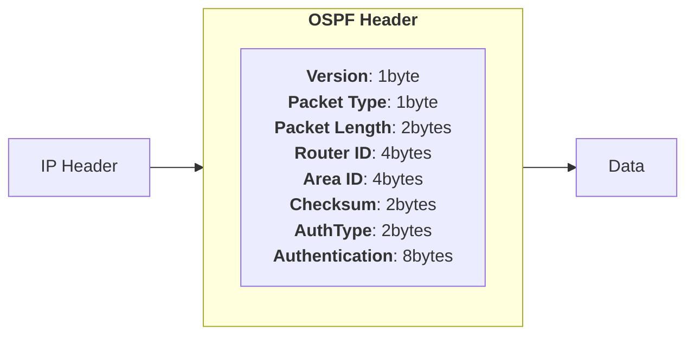
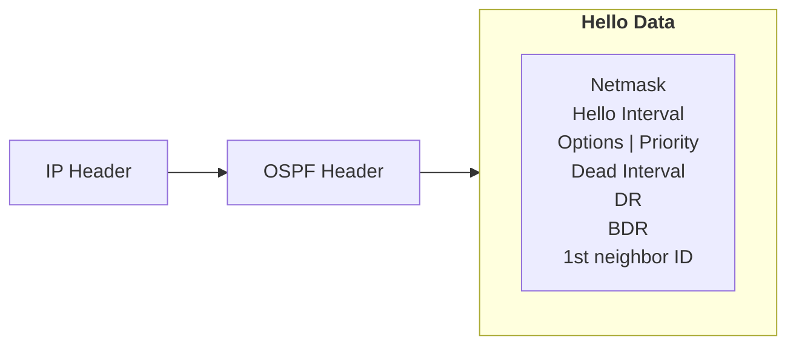

OSPF 是一種鏈路狀態協定，它將路由器介面視為一條 OSPF 鏈路。每當 OSPF 啟動時，它會把所有鏈路的狀態加入本地**鏈路狀態資料庫**。

在 OSPF 網路完全可用之前，必須完成幾個步驟：

- 鄰居發現
- 資料庫同步
- 路由計算

鏈路狀態路由協定會分發並複製一個描述路由拓撲的資料庫。鏈路狀態協定的泛洪演算法確保每臺路由器都具有相同的鏈路狀態資料庫。路由表基於該資料庫計算。

完成上述所有步驟後，每個鄰居上的鏈路狀態資料庫都包含完整的路由域拓撲（網路中有多少臺其他路由器、路由器有多少個介面、路由器之間的鏈路連線哪些網路、每條鏈路的開銷，等等）。

## 基本配置示例 {#basic-configuration-example}

要啟動 OSPF v2 和 v3 例項，請新增例項和骨幹區域：

```ros
/routing/ospf/instance
add name=v2inst version=2 router-id=1.2.3.4
add name=v3inst version=3 router-id=1.2.3.4
/routing/ospf/area
add name=backbone_v2 area-id=0.0.0.0 instance=v2inst
add name=backbone_v3 area-id=0.0.0.0 instance=v3inst
```

該模板匹配 OSPF 應發現鄰居的介面。可直接指定網路或介面。

```ros
/routing/ospf/interface-template
add networks=192.168.0.0/24 area=backbone_v2
add networks=2001:db8::/64 area=backbone_v3
add interfaces=ether1 area=backbone_v3
```

## OSPF 路由器之間的通訊 {#communication-between-ospf-routers}

OSPF 在 IP 網路層上執行，協定號為 89。
目標 IP 地址被設定為鄰居的 IP 地址，或設定為 OSPF 組播地址之一：AllSPFRouters（224.0.0.5）或 AllDRouters（224.0.0.6）。這些地址將在本文後面介紹。
每個 OSPF 封包都以標準的 24 位元組頭部開始。

<center>

</center>

| 欄位 | 描述 |
| :-- | :-- |
| **封包型別** | 存在多種 OSPF 封包型別：Hello 封包、Database Description (DD) 封包、Link-State Request 封包、Link-State Update 封包和 Link-State Acknowledgment 封包。除 Hello 封包外，所有這些封包都用於鏈路狀態資料庫同步。 |
| **Router ID** | 預設使用路由器的一個 IP 地址，除非手動配置。 |
| **Area ID** | 允許 OSPF 路由器將封包關聯到正確的 OSPF 區域。 |
| **校驗和** | 允許接收路由器判斷封包在傳輸過程中是否損壞。 |
| **認證欄位** | 這些欄位允許接收路由器驗證封包的內容未被修改，並且封包來自封包中出現的 Router ID 所對應的 OSPF 路由器。 |

五種 OSPF 封包型別可確保 LSA 在 OSPF 網路中正確泛洪：

- **Hello 封包** - 發現 OSPF 鄰居並建立鄰接關係。
- **Database Description (DD)** - 檢查路由器之間的資料庫同步情況。在鄰接關係建立後交換。
- **Link-State Request (LSR)** - 請求鄰居資料庫中的最新部分。路由資料庫中過時的部分在 DD 交換後確定。
- **Link-State Update (LSU)** - 攜帶一組被專門請求的鏈路狀態記錄。
- **Link-State Acknowledgment (LSack)** - 確認其他封包型別，以確保可靠通訊。

## 鄰居發現 {#neighbor-discovery}

OSPF 透過從已配置的介面週期性傳送 Hello 封包來發現潛在的鄰居。預設情況下，*Hello 封包*每 10 秒傳送一次。你可以透過在 OSPF 介面設定中設定 [`hello-interval`](../../../../cli-reference/routing/ospf/interface-template.md#hello-interval) 來更改此間隔。當路由器收到鄰居返回的、引數匹配的 Hello 封包時，它就會得知存在一個鄰居路由器。

Hello 封包的傳送和接收還使路由器能夠檢測鄰居的故障。如果在 [`dead-interval`](../../../../cli-reference/routing/ospf/interface-template.md#dead-interval)（預設為 40 秒）內未收到 Hello 封包，路由器就會開始繞過該故障進行路由。"Hello" 協定確保相鄰路由器在 Hello 間隔和 Dead 間隔引數上達成一致，從而防止因未及時收到 Hello 封包而錯誤地將鏈路判定為 down 的情況。

<center>


</center>
| 欄位 | 描述 |
| :-- | :-- |
| **網路掩碼** | 發起路由器介面 IP 地址的 IP 掩碼。 |
| **Hello 間隔** | Hello 封包之間的時間間隔（預設 10 秒）。 |
| **選項** | 用於鄰居資訊的 OSPF 選項。 |
| **路由器優先順序** | 一個 8 位值，用於輔助 DR 和 BDR 的選舉（在點對點鏈路中不設定）。 |
| **路由器 Dead 間隔** | 在鄰居被視為 down 之前的時間間隔（預設是 Hello 間隔的四倍）。 |
| **DR** | 當前 DR 的 Router ID。 |
| **BDR** | 當前 BDR 的 Router ID。 |
| **鄰居 Router ID** | 發起路由器的所有鄰居的 Router ID 列表。 |

在每種型別的網段上，Hello 協定的工作方式略有不同。在點對點網段上，只可能有一個鄰居，不需要額外的操作。然而，如果該網段上可以有多個鄰居，則會採取額外操作來提高 OSPF 的效率。

除非滿足以下條件，否則兩臺路由器不會成為鄰居：

- 路由器之間可以雙向通訊。這透過泛洪 Hello 封包來確定。
- 介面應屬於同一區域。
- 介面應屬於同一子網並具有相同的網路掩碼，除非其 network-type 配置為 **point-to-point**。
- 路由器應具有相同的認證選項，並交換相同的密碼（如果有）。
- Hello 封包中的 Hello 間隔和 Dead 間隔應相同。
- Hello 封包中的外部路由和 NSSA 標誌應相同。

:::info
**網路掩碼、優先順序、DR 和 BDR**欄位僅在鄰居透過廣播或 **NBMA** 網段連線時使用。
:::

### 廣播子網上的發現 {#discovery-on-broadcast-subnets}

連線到廣播子網的節點可以傳送單個數據包，而該封包會被所有其他連線的節點接收。這允許自動配置和資訊複製。廣播子網中的另一個重要功能是組播。此功能允許傳送單個數據包，而該封包將被配置為接收組播封包的節點接收。OSPF 利用此功能來發現 OSPF 鄰居並檢測雙向連通性。

每個 OSPF 路由器都會加入 IP 組播組 **AllSPFRouters**（224.0.0.5）。然後，路由器會週期性將其 Hello 封包組播到 IP 地址 224.0.0.5。加入同一組的所有其他路由器都將收到組播的 Hello 封包。透過這種方式，OSPF 路由器只需傳送單個數據包，而不是向該網段上的每個鄰居分別傳送封包，就能維護與所有其他 OSPF 路由器的關係。

這種方法具有幾個優點：

- 透過組播或廣播 Hello 封包自動發現鄰居。
- 與其他子網型別相比，頻寬佔用更少。
- 在廣播網段上存在 n\*(n-1)/2 個鄰居關係，但只需傳送 n 個 Hello 封包即可維護這些關係。
- 如果廣播具備組播能力，OSPF 可在不干擾廣播網段上非 OSPF 節點的情況下執行。
- 如果不支援組播能力，所有路由器都將收到廣播的 Hello 封包，即使某個節點不是 OSPF 路由器。

### NBMA 子網上的發現 {#discovery-on-nbma-subnets}

非廣播多路訪問（NBMA）網段與廣播網段類似。它們支援兩臺以上的路由器。唯一的區別是 NBMA 不支援資料鏈路廣播能力。由於這一限制，OSPF 鄰居必須最初透過配置來發現。在 RouterOS 上，靜態鄰居配置在 [`/routing/ospf/static-neighbor`](../../../../cli-reference/routing/ospf/static-neighbor.md) 選單中設定。為減少 Hello 流量，連線到 NBMA 子網的大多數路由器應分配 Router Priority 為 0（RouterOS 中預設設定）。有資格成為指定路由器的路由器應具有非 0 的優先順序值。這確保在 DR 和 BDR 選舉期間，Hello 封包只發送給有資格的路由器。

### PTMP 子網上的發現 {#discovery-on-ptmp-subnets}

Point-to-MultiPoint 將網路視為一組點對點鏈路。

按照設計，PTMP 網路不具備廣播能力，因此 OSPF 鄰居必須最初透過配置來發現，這與 NBMA 網路相同。所有通訊都透過鄰居之間直接傳送單播封包來進行。在 RouterOS 上，靜態鄰居配置在 [`/routing/ospf/static-neighbor`](../../../../cli-reference/routing/ospf/static-neighbor.md) 選單中設定。點對多點子網上不會選舉指定路由器和備份指定路由器。

對於支援廣播的 PTMP 網路，可以使用名為 "ptmp-broadcast" 的混合型別。此網路型別使用組播 Hello 封包自動發現鄰居，並檢測鄰居之間的雙向通訊。在發現鄰居後，"ptmp-broadcast" 會直接向已發現的鄰居傳送單播封包。此模式與 RouterOS v6 的 "ptmp" 型別相容。

## 主從關係 {#master-slave-relation}

在資料庫同步開始之前，必須建立用於交換資訊的層級順序，以確定哪臺路由器先發送 **Database Descriptor**（**DD**）封包（**Master**）。主路由器是 Router ID 較高的那臺路由器。這是一種基於路由器 [`priority`](../../../../cli-reference/routing/ospf/interface-template.md#priority) 的關係，用於安排鄰居之間的資料交換，並且不影響 DR/BDR 選舉（**DR** 並不總是必須是 **Master**）。

## 資料庫同步 {#database-synchronization}

OSPF 路由器之間的鏈路狀態資料庫同步非常重要。未同步的資料庫可能導致路由表計算錯誤，從而造成路由環路或黑洞。

OSPF 使用兩種型別的資料庫同步：

- 初始資料庫同步。
- 可靠泛洪。

當兩個鄰居之間的連線首次建立時，會發生*初始資料庫同步*。OSPF 在鄰居連線首次建立時使用顯式資料庫下載。此過程稱為 **Database exchange**。OSPF 路由器不是傳送整個資料庫，而是按順序在一系列 OSPF **Database Description (DD)** 封包中僅傳送其 LSA 頭部。路由器只有在前一個數據包被確認後才會傳送下一個 DD 封包。當收到完整的 DD 封包序列後，路由器就知道自己缺少哪些 LSA，以及哪些 LSA 更新。然後，路由器傳送 **Link-State Request (LSR)** 封包請求所需的 LSA，鄰居則透過在 **Link-State Update (LSU)** 封包中泛洪 LSA 來響應。收到所有更新後，鄰居就被稱為**完全鄰接**。

可靠泛洪是另一種資料庫同步方法。此方法用於鄰接關係已經建立，且 OSPF 路由器必須通知其他路由器 LSA 變化的情況。當 OSPF 路由器收到這樣的 Link State Update 時，它會在鏈路狀態資料庫中安裝新的 LSA，向傳送方回送確認封包，將 LSA 重新封裝到新的 LSU 中，並將其傳送到除接收介面之外的所有介面。

OSPF 透過比較序列號來判斷 LSA 是否為最新。序列號從 0x80000001 開始。數字越大，LSA 越新。每次泛洪該記錄時，序列號都會遞增，而接收更新的鄰居會重設 Maximum age 計時器。LSA 每 30 分鐘重新整理一次，但如果沒有重新整理，LSA 會在資料庫中保留最長 60 分鐘的最大老化時間。

資料庫並非總是在所有 OSPF 鄰居之間同步。OSPF 根據網段決定是否必須同步資料庫。例如，在點對點鏈路上，路由器之間始終同步資料庫。在乙太網網路上，資料庫只在某些鄰居對之間同步。

### 廣播子網上的同步 {#synchronization-on-broadcast-subnets}

在廣播網段上存在 n\*(n-1)/2 個鄰居關係。如果 OSPF 路由器嘗試與該子網上的每臺 OSPF 路由器同步，就會在子網上傳送大量 Link State Update 和確認。


透過為每個廣播子網選舉一個**指定路由器**和一個**備份指定路由器**來解決此問題。所有其他路由器僅與這兩臺選舉出的路由器同步並形成鄰接關係。這種方法將鄰接關係數量從 n\*(n-1)/2 減少到僅 2n-3。

右圖展示了廣播子網上的鄰接關係形成。R1 是指定路由器，R2 是備份指定路由器。例如，如果 R3 要向 R1 和 R2 泛洪 Link State Update (LSU)，該路由器會將 LSU 傳送到 IP 組播地址 **AllDRouters**（224.0.0.6），只有 DR 和 BDR 監聽此組播地址。然後，指定路由器傳送發往 AllSPFRouters 的 LSU，以更新其餘路由器。

#### DR 選舉 {#dr-election}

DR 和 BDR 路由器根據 Hello 封包中收到的資料進行選舉。子網上的第一臺 OSPF 路由器始終被選舉為指定路由器。當新增第二臺路由器時，它將成為備份指定路由器。當現有 DR 或 BDR 發生故障時，將根據配置的路由器 [`priority`](../../../../cli-reference/routing/ospf/interface-template.md#priority) 選舉新的 DR 或 BDR。優先順序最高的路由器將成為新的 DR 或 BDR。

充當指定路由器或備份指定路由器會消耗額外資源。如果將 Router Priority 設定為 0，該路由器不會參與選舉過程。當某些較慢的路由器不能成為 DR 或 BDR 時，這一點很重要。

### NBMA 子網上的同步 {#synchronization-on-nbma-subnets}

NBMA 網路上的資料庫同步與廣播網路上的同步類似。會選舉 DR 和 BDR。資料庫最初僅與 DR 和 BDR 路由器交換，泛洪始終透過 DR 進行。唯一的區別是 Link State Update 必須複製並分別傳送到每個相鄰路由器。
