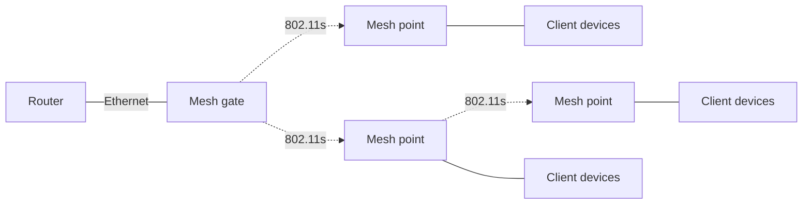

**Package：** `wifi-qcom-be`、`wifi-mediatek`

:::warning

- MeshPoint 可在 `wifi-qcom-be` 與 `wifi-mediatek` 上運作。它無法在 `wifi-qcom` 或 `wifi-qcom-ac` 上運作。
- MeshPoint 需在 CLI 中設定，不提供 GUI 支援。
- mesh 對等連結使用 WPA3-PSK（SAE）。802.11s 不支援 WPA2-PSK。
:::

MeshPoint 是 RouterOS 對 IEEE 802.11s Layer 2 mesh 的實作。可用它在沒有乙太網路佈線的情況下連接存取點，並透過多個無線躍點延伸 Layer 2 網路。

Mesh 節點會透過 Wi-Fi 依 Mesh ID 互相探索，並建立 WPA3-PSK（SAE）對等連結。mesh 連結不支援 WPA2-PSK。MeshPoint 具備自我修復能力：它會選擇成本最低的路徑，並在連結失效時重新路由流量。

mesh 中的每台裝置都是 mesh 節點。mesh gate 是具備有線上行連結至 LAN 的節點；它會透過 Wi-Fi 公告通往有線網路的路徑，讓其他節點能夠連上 LAN 與網際網路。沒有有線上行連結的節點會彼此建立無線對等連結，並將用戶端流量經過一個或多個無線躍點轉送至 mesh gate。一個 mesh 可以有多個 gate。每個節點也可以執行一般的 AP 介面供本機用戶端使用；用戶端連線至該 AP，而非 mesh 連結。mesh、AP 與乙太網路介面會橋接在一起，因此用戶端看到的是同一個 Layer 2 網路。

mesh 連結是節點之間的回傳鏈路；AP 介面則是用戶端的前傳鏈路。

簡單來說：

- mesh 節點的所有埠都會橋接。每個節點都使用相同的 Mesh ID（`configuration.ssid`）與 WPA3-PSK 密碼。
- 用於 mesh 連結的 Wi-Fi 介面（例如 `wifi1`）以 MeshPoint 模式運作。
- 第二個 Wi-Fi 介面（例如 `wifi2`）以 AP 模式運作，讓用戶端裝置可透過 mesh 連上 LAN。
- 用戶端流量會逐節點轉送，直到抵達具備有線上行連結的節點。
- 若連結失效，mesh 會自動重新路由流量。

## Topology

A MeshPoint 網路具有下列角色：

- Mesh 閘道：具備連接至 LAN 之乙太網路上行鏈路的 mesh 節點。它會以 HWMP Root Announcements（RANN）公告通往有線網路的路徑。
- Mesh 節點：以 Mesh ID 加入 mesh，並透過對等連結轉送流量的節點。它可透過 AP 介面服務本機用戶端。

所有節點都使用相同的 Mesh ID、WPA3-PSK 通行碼與國家/地區設定。無線電介面必須支援共同的頻段與頻道。Mesh 會在第 2 層轉送乙太網路訊框，因此所有節點都位於相同的第 2 層網路，且用戶端 MAC 位址會跨躍點保留。



Mesh 節點會與範圍內的每個鄰居建立對等關係。HWMP 會比較每條路徑的無線傳輸時間連結度量（資料速率、訊框錯誤率與頻道額外負擔），以選出通往 Mesh 閘道的有效路徑。系統會採用總度量最低的路徑。可存在多個 Mesh 閘道，且每個節點會選出通往閘道的最佳路徑。若連結失效，HWMP 會重新路由流量。

:::warning

路徑選擇無法消除干擾，且每多一跳都會降低輸送量並增加延遲。

在單一無線電的 mesh 中，所有節點共用一個頻道及其無線傳輸時間。例如，在 3 跳鏈路 A-B-C-D 中，從 D 到 A 的訊框會在同一頻道上傳輸三次：D→C、C→B、B→A。同一時間只能有一個節點傳輸，因此每一跳都會再次消耗相同的無線傳輸時間。輸送量每跳大約下降一半。隱藏節點碰撞與同一頻道上的鄰近 AP 會使長鏈路更糟。

對於長鏈路，請將 5 GHz 用於 mesh 回傳、減少跳數，或使用有線上行鏈路。
:::

## Configuration

:::warning
Wi-Fi 與橋接變更可能會中斷管理連線。請透過乙太網路埠連線，或使用 [Winbox](/docs/management-tools/winbox) 的 Neighbors 索引標籤，依 MAC 位址連線。
:::

Mesh 閘道可以是具備 DHCP 伺服器的路由器，或是將 mesh 橋接到 LAN 的第 2 層存取點。Mesh 節點是存取點，並透過其 MeshPoint Wi-Fi 介面將用戶端流量橋接到 mesh 中。

如果 Mesh 閘道是具備 DHCP 伺服器的路由器，請確認所需的 LAN 乙太網路埠、MeshPoint Wi-Fi 介面與 AP Wi-Fi 介面都位於同一個橋接中。

如果 mesh gate 是純 Layer 2 AP，請確認所有埠（Ethernet、Wi-Fi MeshPoint 與 AP）都已橋接在一起，且該橋接具有 IP 位址，無論是手動指派或透過 DHCP 取得。

mesh gate 與 mesh node 之間沒有其他設定差異。請在 mesh gate 與 mesh node 上以相同方式設定 MeshPoint Wi-Fi 介面（只要確認 Wi-Fi 介面加入正確的橋接即可）。

### MeshPoint 介面

將其中一個無線電設定為 MeshPoint 模式：

```ros
/interface/wifi
set [find default-name=wifi1] configuration.country=Latvia .mode=meshpoint .ssid=mesh-mesh datapath.bridge=bridge disabled=no security.authentication-types=wpa3-psk .passphrase=mesh-password
```

- `configuration.mode=meshpoint` - 選取 IEEE 802.11s MeshPoint 模式。
- `configuration.ssid=mesh-mesh` - 設定 Mesh ID。此值不是用戶端 SSID。
- `configuration.country=Latvia` - 設定法規網域。請使用您所在的國家。
- `security.authentication-types=wpa3-psk` - 使用 SAE 驗證 mesh 對等節點。
- `security.passphrase=mesh-password` - 設定 mesh 密碼。請在每個節點上使用相同密碼。
- `datapath.bridge=bridge` - 將 mesh 介面加入橋接。

請在每個 mesh gate 與 mesh node 上套用相同的 MeshPoint Wi-Fi 介面設定，讓網路中的每部裝置都有一個介面設定為 MeshPoint。

### 選用 AP 介面

將第二個 Wi-Fi 介面設定為 AP：

```ros
set [find default-name=wifi2] configuration.country=Latvia .mode=ap .ssid=SSID-for-clients datapath.bridge=bridge disabled=no security.authentication-types=wpa2-psk .passphrase=client-password
```

- `configuration.mode=ap` - AP 模式。
- `configuration.ssid=SSID-for-clients` - 用戶端 SSID。
- `security.authentication-types=wpa2-psk` 與 `security.passphrase=client-password` - 用戶端安全性。
- `datapath.bridge=bridge` - 將 AP 介面加入橋接。

如果沒有其他介面可用，請在 MeshPoint 介面上建立虛擬 AP：

```ros
/interface/wifi
add name=wifi3 master-interface=wifi1 configuration.mode=ap .ssid=SSID-for-clients datapath.bridge=bridge disabled=no security.authentication-types=wpa2-psk .passphrase=client-password
```

虛擬 AP 使用與 MeshPoint 介面相同的通道。它與 Mesh 連結共用無線傳輸時間，因此輸送量會低於使用專用無線電的情況。

### 選用的通道控制

啟動時，MeshPoint 會掃描相符的 Mesh ID，並選擇對等節點所在的通道。如果 Mesh 在多個通道上可見，節點會收斂至 MAC 位址最低的對等節點所在通道（即最小的位址值，用來做為確定性的決勝依據）。初始掃描後，Mesh 無線電會定期執行背景掃描，預設為每 2–3 小時一次。

使用 `channel.reselect-interval` 或 `channel.reselect-time` 控制背景掃描：

```ros
/interface/wifi
set [find default-name=wifi1] channel.reselect-interval=02:00..03:00
# 或改用時鐘時間窗口：
set [find default-name=wifi1] channel.reselect-time=03:00..04:00
```

這兩個設定都會排定相同的背景掃描。重新選擇可能會觸發通道切換，並短暫中斷 Mesh。

若要讓 Mesh 無線電保持在固定通道，請設定單一的 `channel.frequency`：

```ros
/interface/wifi
set [find default-name=wifi1] channel.frequency=5180
```

## Verification

註冊表會顯示 mesh 對等節點：

```ros
[admin@hAP] > /interface/wifi/registration-table/print
Flags: A - AUTHORIZED
Columns: INTERFACE, SSID, MAC-ADDRESS, DHCP-ADDRESS, DHCP-HOSTNAME, UPTIME, LAST-ACTIVITY, SIGNAL, AUTH-TYPE, BAND
#   INTERFACE  SSID        MAC-ADDRESS        DHCP-ADDRESS    DHCP-HOSTNAME  UPTIME  LAST-ACTIVITY  SIGNAL  AUTH-TYPE  BAND
0 A wifi1      mesh-mesh   XX:XX:XX:XX:XX:02                                 49m14s  0ms            -14                2ghz-ax
```

使用 `/interface/wifi/meshpoint-paths` 顯示 MeshPoint 介面的 HWMP 路徑表：

```ros
/interface/wifi/meshpoint-paths wifi1

Flags: V - SN-VALID
Columns: DESTINATION, NEXT-HOP, HOPS, METRIC, PACKETS-QUEUED, SN, EXPIRATION, DISCOVERY-TIMEOUT, DISCOVERY-RETRIES, PATH-CHANGES
  DESTINATION        NEXT-HOP           HOPS  METRIC  PACKETS-QUEUED   SN  EXPIRATION  DISCOVERY-TIMEOUT  DISCOVERY-RETRIES  PATH-CHANGES
  XX:XX:XX:XX:XX:01  00:00:00:00:00:00     0       0               0    0           0               1600                  0             0
V XX:XX:XX:XX:XX:02  XX:XX:XX:XX:XX:02     1    8257               0  120           0                100                  0             1
```

## Troubleshooting

- 若對等節點未出現在註冊表中，請確認兩個節點使用相同的 Mesh ID（`ssid`）、WPA3-PSK 通行碼、國家與頻段。在每個節點上執行 `/interface/wifi/scan`，確認能看到該 Mesh ID。
- 若用戶端無法取得 IP 位址，請確認 MeshPoint 介面與 AP 介面都使用 `datapath.bridge=bridge`、橋接已設定 DHCP 用戶端，且網路中只有一部 DHCP 伺服器。
- 若節點在拔除乙太網路線後失去管理存取權，請等待對等連結建立，然後檢查註冊表與橋接埠。
- 若傳輸量偏低，請為 mesh 回傳骨幹使用獨立的無線電。共用的無線電會在 mesh 與用戶端流量之間分時共用通道，且每多一跳就會降低傳輸量。

## Notes

:::note

- MeshPoint 可在 `wifi-qcom-be` 與 `wifi-mediatek` 上運作，不支援 `wifi-qcom` 或 `wifi-qcom-ac`。
- 所有 mesh 節點都必須使用相同的 Mesh ID、WPA3-PSK 通行碼與國家。
- 802.11s 對等連結不支援 WPA2-PSK。
- MeshPoint 需在 CLI 中設定，不提供 GUI 支援。
- 允許多個 mesh 閘道。每個節點會自行選擇通往閘道的最佳路徑。
- mesh point 會與範圍內每個鄰居建立對等關係，並由 HWMP 選擇作用中的路徑。
:::
