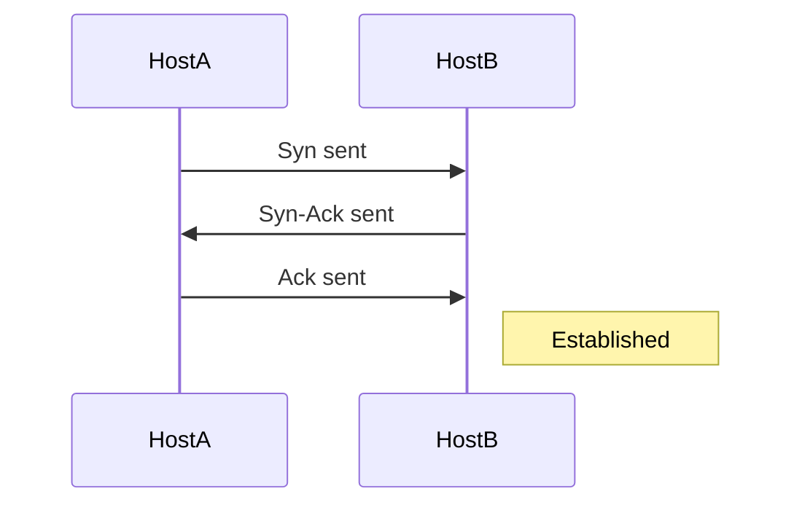
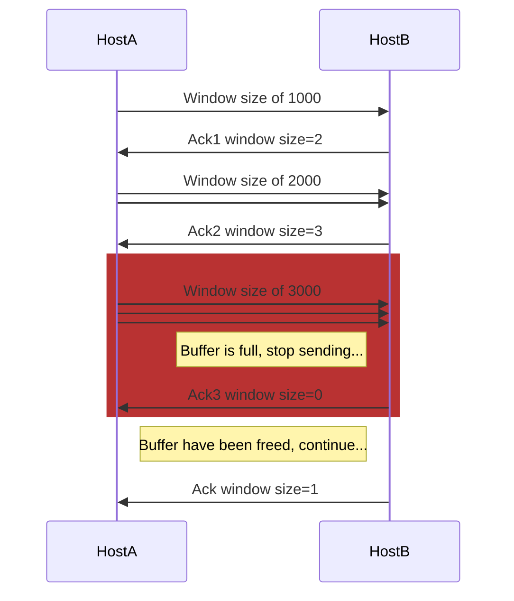
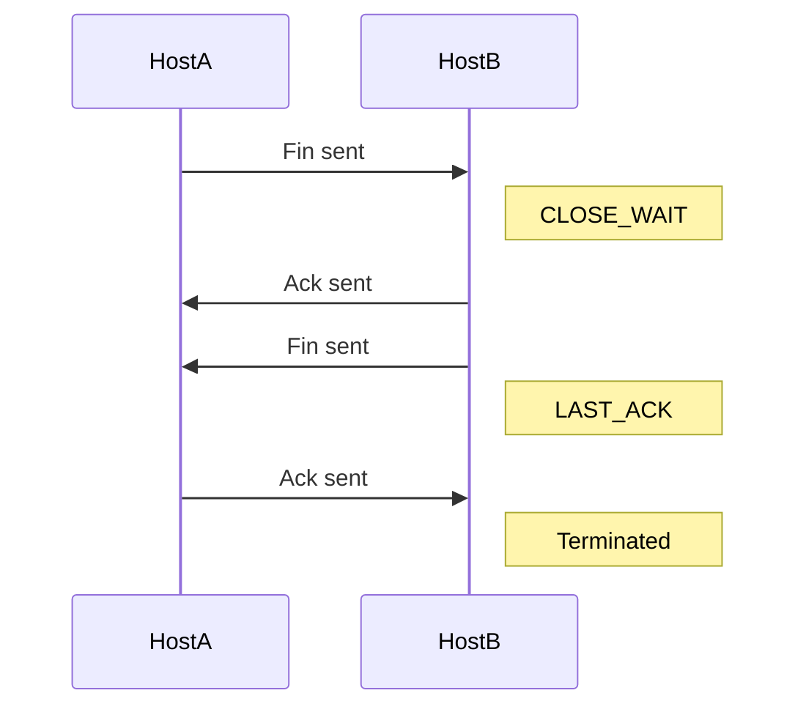

計算機網路由許多不同的元件和協定協同工作組成。為了理解節點到節點通訊是如何發生的這一概念，讓我們熟悉 **OSI 模型** 和 **TCP/IP 模型**。這兩種模型都有助於直觀地理解節點之間的通訊是如何進行的。

### OSI 模型 {#osi-model}

開放系統互連 (OSI) 模型是一個 7 層模型，如今被用作教學工具。OSI 模型最初被構想為構建網路系統的標準架構，但現實世界中的網路遠沒有 OSI 模型所暗示的那樣明確。

- **第 7 層（應用層）** - 定義伺服器與用戶端之間通訊的協定，例如 HTTP 協定。如果 Web 瀏覽器想要下載影像，該協定將組織並執行請求；
- **第 6 層（表示層）** - 確保以可用的格式接收資料。加密在此處完成（但在現實中可能並非如此，例如 IPSec）；
- **第 5 層（會話層）** - 負責建立、管理和關閉用戶端與伺服器之間的會話；
- **第 4 層（傳輸層）** - 傳輸層的主要職責是組裝和重組，資料流被劃分為塊（段），分配序列號並封裝到協定頭中（TCP、UDP 等）；
- **第 3 層（網路層）** - 負責邏輯裝置定址，資料被封裝在 IP 頭中，現在稱為“封包”；
- **第 2 層（資料鏈路層）** - 資料被封裝在自定義頭中，即 802.3（Ethernet）或 802.11（無線），稱為“幀”，並處理流量控制；
- **第 1 層（物理層）** - 傳送和接收位元的通訊介質、電訊號以及硬體介面；

### TCP/IP 模型 {#tcpip-model}

此模型與 OSI 模型具有相同的目的，但更適合現代網路故障排除。與 OSI 模型相比，TCP/IP 是一個 4 層模型：

- **應用層（4）** - 包含 OSI 模型的應用層、表示層和會話層，這顯著簡化了網路故障排除；
- **傳輸層（3）** - 與 OSI 模型中的傳輸層相同（TCP、UDP 協定）；
- **網際層（2）** - 執行與 OSI 模型中網路層相同的功能（包括 ARP、IP 協定）；
- **鏈路層（1）** - 也稱為網路接入層。包含 OSI 模型的第 1 層和第 2 層，因此其主要關注網路節點之間的物理資料交換；

| TCP/IP            | OSI 模型          | 協定                       |
|:--|:--|:--|
| 應用層 | 應用層  | DNS、DHCP、HTTP、SSH 等         |
|                   | 表示層 | JPEG、MPEG、PICT 等             |
|                   | 會話層      | PAP、SCP、ZIP 等              |
| 傳輸層   | 傳輸層    | TCP, UDP                        |
| 網際層    | 網路層      | ICMP, IGMP, IPv4, IPv6, IPSec   |
| 鏈路層        | 資料鏈路層    | ARP、CDP、MPLS、PPP 等        |
|                   | 物理層     | Bluetooth、Ethernet、Wi-Fi 等 |

## Ethernet {#ethernet}

計算機網路中最常用的鏈路層協定（OSI 第 2 層）是 Ethernet 協定。為了進行通訊，每個節點都有一個唯一分配的地址，稱為 **MAC**（Media Access Control 地址），有時也稱為 Ethernet 地址。

它長 48 位，通常由製造商固定（無法更改），但如今 MAC 地址的自定義已廣泛使用，RouterOS 也允許設定自定義 MAC 地址。

最常用的 MAC 格式是用冒號分隔的 6 個十六進位制數（`D4:CA:6D:01:22:96`）

RouterOS 會在所有類似 Ethernet 的介面（Wireless、60G、VPLS 等）的配置中顯示 MAC 地址。

```ros
[admin@rack1_b32_CCR1036] /interface ethernet> print 
Flags: X - disabled, R - running, S - slave 
 #    NAME                  MTU MAC-ADDRESS       ARP             SWITCH               
 0 R  ether1               1500 D4:CA:6D:01:22:96 enabled        
 1 R  ether2               1500 D4:CA:6D:01:22:97 enabled        
 2 R  ether3               1500 D4:CA:6D:01:22:98 enabled        
 3    ether4               1500 D4:CA:6D:01:22:99 enabled        
 4    ether5               1500 D4:CA:6D:01:22:9A enabled        
 5    ether6               1500 D4:CA:6D:01:22:9B enabled        
 6    ether7               1500 D4:CA:6D:01:22:9C enabled        
 7 R  ether8               1500 D4:CA:6D:01:22:9D enabled        
 8    sfp-sfpplus1         1500 D4:CA:6D:01:22:94 enabled        
 9    sfp-sfpplus2         1500 D4:CA:6D:01:22:95 enabled 
```

在 Ethernet 網路上轉發幀有三種類型：

- **單播** - 帶有單播地址的幀會被髮送到衝突域內的所有節點，衝突域通常是兩個節點之間的 Ethernet 電纜，或者在無線情況下是所有能夠檢測到無線訊號的接收方。只有具有匹配 MAC 地址的遠端節點才會接受該幀（除非啟用了混雜模式）
- **廣播** - 特殊地址之一（`FF:FF:FF:FF:FF:FF`），廣播幀會被所有節點接受並在第 2 層網路上轉發。
- **組播** - 帶有組播地址的幀會被所有配置為監聽該地址的節點接收。

## IP 網路 {#ip-networking}

Ethernet 協定足以在 Ethernet 網路上的兩個節點之間傳輸資料，但不足以在跨越多個 Ethernet 段的多個跳數節點之間傳輸資料。對於 Internet/網路層（OSI 第 3 層），使用 IP（Internet Protocol）透過唯一的邏輯地址來標識主機。

當前大多數網路使用 **IPv4**，它是用點分十進位制表示法書寫的 32 位地址（`192.168.88.1`），但 **IPv6**（128 位地址）的使用正在擴大。

可以為介面新增多個 IP 地址，也可以讓介面不分配任何地址。在橋接或 PPPoE 連線的情況下，物理介面可能沒有分配任何地址，但仍然完全可用。為包含在網橋中的物理介面配置 IP 地址，實際上意味著在網橋介面本身上進行設定。

### 網路掩碼 {#netmasks}

可能存在多個邏輯網路，為了確定 IP 地址屬於哪個網路，需要使用 **網路掩碼**。**網路掩碼** 通常指定為用於標識邏輯網路的位數。格式也可以採用十進位制表示法，例如，24 位網路掩碼可以寫作 `255.255.255.0`

### IPv4 地址 {#ipv4-addresses}

IPv4 使用 4 位元組地址，這些地址被劃分為四個 8 位欄位，稱為八位組。每個八位組轉換為十進位制格式並用點分隔。例如：

```
11000000 10101000 00000011 00011000 => 192.168.3.24
```

讓我們仔細看看 192.168.3.24/24，以及如何根據網路掩碼確定有效範圍：

```
11000000 10101000 00000011 00011000 => 192.168.3.24
11111111 11111111 11111111 00000000 => /24 or 255.255.255.0
```

在此示例中，高 24 位被掩碼，留下 0-255 的範圍。  
此範圍由三種地址型別組成：

- **網路地址** - 範圍中的第一個地址用於標識網路（在我們的示例中，網路地址將是 192.168.3.0）

- **廣播地址** - 範圍中的最後一個/最高地址（在我們的示例中是 192.168.3.255）。廣播地址用於將資料傳送到所有可能的目的地（**全主機廣播**），這允許傳送方只發送一次資料，而所有接收方都會收到其副本。在 IPv4 協定中，地址 255.255.255.255 用於**本地廣播**。此外，還可以向網路廣播地址進行定向（受限）廣播。
- **單播地址** - 範圍中的所有其他地址可用於標識網路中的特定主機（在我們的示例中，用於主機標識的範圍是 1 到 254）。

與 Ethernet 協定中一樣，也有用於**組播**的特殊地址範圍。組播地址用於關聯一組感興趣的接收方。在 IPv4 中，地址 `224.0.0.0` 到 `239.255.255.255` 被指定為組播地址。傳送方從其單播地址向組播組地址傳送單個數據報，中間路由器負責製作副本並將其傳送給所有已加入相應組播組的接收方；

邏輯 IP 網路、單播、廣播和組播的視覺化：


還有一些為特殊目的保留的地址範圍：

- [私有地址範圍（RFC 1918）](https://tools.ietf.org/html/rfc1918)，它應僅在本地網路中使用，並且在轉發到網際網路時通常會被丟棄：
  - 10.0.0.0/8 - 起始：10.0.0.0；結束：10.255.255.255
  - 172.16.0.0/12 - 起始：172.16.0.0；結束：172.31.255.255
  - 192.168.0.0/16 - 起始：192.168.0.0；結束：192.168.255.255

- 198.18.0.0/15 - 基準測試
- 192.88.99.0/24 - 6to4 中繼任播地址範圍
- 192.0.2.0/24、198.51.100.0/24、203.0.113.0/24 - 文件用途
- 169.254.0.0/16 - 自動配置地址範圍

#### 點對點定址 {#point-to-point-addressing}

點對點定址，顧名思義，可用於設定僅由兩個節點組成的第 3 層網路。設定這種定址有兩種方式：

- 使用 /31 地址範圍
- 使用 /32 地址，其中網路地址設定為遠端節點的 IP 地址。  
  例如：

  ```mermaid
  flowchart LR
    H1 --- H2

    H1["**Host 1**<br />____________________<br /> **Address**: 192.168.0.1/32<br />**Network**: 192.168.0.2"]
    H2["**Host 2**<br />____________________<br /> **Address**: 192.168.0.2/32<br />**Network**: 192.168.0.1"]

    style H1 text-align:left
    style H2 text-align:left
  ```

#### 地址配置 {#address-configuration}

考慮這樣一種設定：兩臺路由器透過電纜直接連線，而我們不想浪費地址空間：

路由器 1：

```ros
/ip address
add address=10.1.1.1/32 interface=ether1 network=172.16.1.1
```

路由器 2：

```ros
/ip address
add address=172.16.1.1/32 interface=ether1 network=10.1.1.1
```

## ARP 以及將所有內容串聯起來 {#arp-and-tying-it-all-together}

儘管 IP 封包使用 IP 地址進行定址，但實際將資料從一臺主機傳輸到另一臺主機時必須使用硬體地址。

這就引出了 **Address Resolution Protocol (ARP)**，它用於將主機的 **IPv4** 地址對映到硬體地址（MAC）。**ARP** 協定在 [RFC 826](https://tools.ietf.org/html/rfc826) 中有所引用。它已成為過去，在 IPv6 中被組播取代，但只要 IPv4 仍在使用，它就會繼續存在。

每個網路裝置都有一個當前使用的 ARP 條目表。通常該表是動態構建的，但為了提高網路安全性，可以透過新增靜態條目來部分或完全靜態構建該表。

當局域網中的一臺主機想要向該網路中的另一臺主機發送 IP 封包時，它必須在其 ARP 快取中查詢目標主機的 Ethernet MAC 地址。如果目標主機的 MAC 地址不在 ARP 表中，則會發送 ARP 請求以查詢具有相應 IP 地址的裝置。ARP 向 LAN 上的所有裝置傳送廣播請求訊息，要求具有指定 IP 地址的裝置回覆其 MAC 地址。將 IP 地址識別為自己的裝置會返回帶有自身 MAC 地址的 ARP 響應：


讓我們進行一個簡單的配置，並仔細觀察 **Host A** 嘗試 ping **Host C** 時的過程。

首先，我們在 **Host A** 上新增 IP 地址：

```ros
/ip address add address=10.155.101.225/24 interface=ether1
```

**主機 B**：

```ros
/ip address add address=10.155.101.221/24 interface=ether1
```

**主機 C**：

```ros
/ip address add address=10.155.101.217/24 interface=ether1
```

讓我們執行一個將封包轉儲儲存到檔案的封包嗅探器，並在 **Host A** 上執行 ping 命令：

```ros
/tool sniffer
  set file-name=arp.pcap filter-interface=ether1
  start 
/ping 10.155.101.217 count=1
/tool sniffer stop
```

現在你可以從路由器下載 arp.pcap 檔案，並在 Wireshark 中開啟進行分析：


- **Host A** 傳送 **ARP** 訊息，詢問誰擁有 “10.155.101.217”
- **Host C** 回覆稱，可以透過 MAC 地址 08:00:27:3C:79:3A 訪問 10.155.101.217
- **Host A** 和 **Host C** 現在都已更新其 **ARP** 表，並且可以傳送 ICMP（ping）封包

如果透過執行 `/ip/arp/print` 檢視兩臺主機的 ARP 表，你應該能夠看到相關條目：

```routeros
[admin@host_a] /ip arp> print 
Flags: D - DYNAMIC; C - COMPLETE
Columns: ADDRESS, MAC-ADDRESS, INTERFACE, VRF, STATUS
 #    ADDRESS         MAC-ADDRESS       INTERFACE     VRF   STATUS
 0 DC 10.155.101.217  08:00:27:3C:79:3A ether1        main  reachable

 [admin@host_b] /ip arp> print 
Flags: D - DYNAMIC; C - COMPLETE
Columns: ADDRESS, MAC-ADDRESS, INTERFACE, VRF, STATUS
 #    ADDRESS         MAC-ADDRESS       INTERFACE     VRF   STATUS
 0 DC 10.155.101.225  08:00:27:85:69:B5 ether1        main  reachable
```

可能存在需要不同行為的場景。RouterOS 允許為支援 **ARP** 的介面配置不同模式：

- **Enabled** - ARP 將被自動發現，新的動態條目將被新增到 ARP 表中。這是介面的預設模式。
- **Disabled** - 如果介面上關閉了 ARP 功能，則路由器不會應答來自用戶端的 ARP 請求。因此，也應向用戶端新增靜態 ARP 條目。例如，
  Host A:

  ```ros
  /interface/set ether1 arp=disabled
  /ip arp add mac-address=08:00:27:3C:79:3A address=10.155.101.217 interface=ether1
  ```

  主機 B：

  ```ros
  /ip arp add mac-address=08:00:27:85:69:B5 address=10.155.101.225 interface=ether1
  ```

- **Reply Only** - 如果介面上的 ARP 屬性設定為 `reply-only`，則路由器只回復 ARP 請求。鄰居 MAC 地址將使用 `/ip/arp` 靜態解析，但無需像停用 ARP 的情況那樣將路由器的 MAC 地址新增到其他主機的 ARP 表中。

- **Proxy ARP** - 正確配置了代理 ARP 功能的路由器可在直接連線的網路之間充當透明代理。例如，如果你希望為撥入（PPP、PPPoE、PPTP）用戶端分配與所連線 LAN 上使用的相同地址空間中的 IP 地址，這種行為會很有用。

- **Local Proxy ARP** - 如果介面上的 arp 屬性設定為 `local-proxy-arp`，則路由器僅對此介面執行代理 ARP 的收發。也就是說，對於進入和離開同一介面的流量。在正常 LAN 中，預設行為是兩臺網路主機直接相互通訊，而不涉及路由器。
  路由器將使用路由器自身介面的 MAC 地址（而不是另一臺主機的 MAC 地址）響應所有用戶端主機。

  例如，如果 Host A（192.168.88.2/24）查詢 Host B（192.168.88.3/24）的 MAC 地址，路由器將使用自己的 MAC 地址進行響應。換句話說，如果啟用了 local-proxy-arp，路由器將承擔在 Host A 192.168.88.2 和 Host B 192.168.88.3 之間轉發流量的責任。Host A 和 Host B 上的所有 ARP 快取條目都將引用路由器的 MAC 地址。在這種情況下，路由器正在為整個子網 192.168.88.0/24 執行 local-proxy-arp。

  RouterOS local-proxy-arp 的一個示例可以是帶有 DHCP 伺服器和隔離網橋埠的網橋設定，其中同一子網中的主機只能透過網橋 IP 在第 3 層相互訪問。

  ```ros
  /interface bridge
  add arp=local-proxy-arp name=bridge1
  /interface bridge port
  add bridge=bridge1 horizon=1 interface=ether2
  add bridge=bridge1 horizon=1 interface=ether3
  add bridge=bridge1 horizon=1 interface=ether4
  ```

  這項技術有不同的名稱：
  - 在 RFC 3069 中稱為 VLAN Aggregation；
  - Cisco 和 Allied Telesis 稱之為 Private VLAN；
  - Hewlett-Packard 稱之為 Source-Port filtering 或 port-isolation；
  - Ericsson 稱之為 MAC-Forced Forwarding（RFC Draft）。

#### Proxy ARP 示例 {#proxy-arp-example}

讓我們看看示例圖。  


**Host A**（172.16.1.2）位於子網 A，想要向子網 B 上的 **Host D**（172.16.2.3）傳送封包。**Host A** 具有 /16 子網掩碼，這意味著它認為自己直接連線到整個 172.16.0.0/16 網路（同一個 LAN）。它在子網 A 上廣播以查明 **Host D** 的 MAC 地址。

來自封包分析器軟體的資訊：

```text
 No.     Time   Source             Destination       Protocol  Info

 12   5.133205  00:1b:38:24:fc:13  ff:ff:ff:ff:ff:ff  ARP      Who has 173.16.2.3?  Tell 173.16.1.2

Packet details:

Ethernet II, Src: (00:1b:38:24:fc:13), Dst: (ff:ff:ff:ff:ff:ff)
    Destination: Broadcast (ff:ff:ff:ff:ff:ff)
    Source: (00:1b:38:24:fc:13)
    Type: ARP (0x0806)
Address Resolution Protocol (request)
    Hardware type: Ethernet (0x0001)
    Protocol type: IP (0x0800)
    Hardware size: 6
    Protocol size: 4
    Opcode: request (0x0001)
    [Is gratuitous: False]
    Sender MAC address: 00:1b:38:24:fc:13
    Sender IP address: 173.16.1.2
    Target MAC address: 00:00:00:00:00:00
    Target IP address: 173.16.2.3
```

透過此 ARP 請求，**Host A**（172.16.1.2）正在要求 **Host D**（172.16.2.3）傳送其 MAC 地址。第 2 層廣播意味著該幀將被髮送到同一第 2 層廣播域中的所有主機，其中包括路由器的 **ether0** 介面，但不會到達 **Host D**，因為路由器預設不轉發第 2 層廣播。

要解決此問題，我們需要在 ether0 上啟用 `proxy-arp`：

```ros
/interface/ethernet set ether0 arp=proxy-arp
```

現在，路由器知道目標地址（172.16.2.3）位於另一個子網且可達，它會使用自己的 **MAC** 地址向 **Host A** 傳送單播回覆。基本上，它是在說“將這些封包傳送給我，我會把它們送到需要去的地方。”

```text
No.     Time   Source            Destination         Protocol   Info

13   5.133378  00:0c:42:52:2e:cf  00:1b:38:24:fc:13   ARP        172.16.2.3 is at 00:0c:42:52:2e:cf

Packet details:

Ethernet II, Src: 00:0c:42:52:2e:cf, Dst: 00:1b:38:24:fc:13
   Destination: 00:1b:38:24:fc:13
   Source: 00:0c:42:52:2e:cf
   Type: ARP (0x0806)
Address Resolution Protocol (reply)
   Hardware type: Ethernet (0x0001)
   Protocol type: IP (0x0800)
   Hardware size: 6
   Protocol size: 4
   Opcode: reply (0x0002)
   [Is gratuitous: False]
   Sender MAC address: 00:0c:42:52:2e:cf
   Sender IP address: 172.16.1.254
   Target MAC address: 00:1b:38:24:fc:13
   Target IP address: 172.16.1.2
```

當 Host A 收到 ARP 響應時，它會更新其 ARP 表，如下所示：

```text
C:\Users\And>arp -a
Interface: 173.16.2.1 --- 0x8
  Internet Address      Physical Address      Type
  173.16.1.254          00-0c-42-52-2e-cf    dynamic
  173.16.2.3            00-0c-42-52-2e-cf    dynamic
  173.16.2.2            00-0c-42-52-2e-cf    dynamic
```

更新 MAC 表後，**Host A** 將所有發往 **Host D**（172.16.2.3）的封包直接轉發到路由器介面 ether0（00:0c:42:52:2e:cf），路由器再將封包轉發給 **Host D**。子網 A 中主機上的 ARP 快取會為子網 B 中的所有主機填充路由器的 MAC 地址。因此，所有發往子網 B 的封包都會發送到路由器。路由器會將這些封包轉發給子網 B 中的主機。

使用代理 ARP 時，主機的多個 IP 地址會對映到單個 MAC 地址。

## 傳輸層 {#transport-layer}

此層中的協定為應用提供端到端通訊服務。這些協定應透過交換資料接收確認並重傳丟失的封包，確保封包按序到達且無錯誤。

最著名且廣泛使用的是 **Transmission Control Protocol (TCP)**，它用於面向連線的傳輸，幷包含可靠資料傳輸的機制。

無連線的 **User Datagram Protocol (UDP)** 是另一種用於簡單資料傳輸的常見協定。

### TCP 協定操作 {#tcp-protocol-operation}

面向連線的協定在建立正確連線之前不會發送任何資料。每當傳送設備嘗試與遠端節點建立連線時，**TCP** 都會使用多步握手過程。結果會建立端到端虛擬（邏輯）電路，在其中使用流量控制和確認來實現可靠交付。TCP 有幾種用於連線建立和終止過程的訊息型別。

**三次握手**過程：

1. 需要初始化連線的 **HostA** 會向目標 **HostB** 傳送一個 **SYN**（同步）封包，其中包含建議的初始序列號。
2. 當 **HostB** 收到 **SYN** 訊息時，會回覆一個數據包，其中 TCP 頭中的 **SYN** 和 **ACK** 標誌都置位（SYN-ACK）。
3. 當 **HostA** 收到 SYN-ACK 時，會回覆 **ACK**（確認）封包。**HostB** 收到 **ACK**，此時連線處於 **ESTABLISHED;** 狀態；



現在我們知道 **TCP** 連線是如何建立的，還需要了解資料傳輸是如何管理和維護的。

面向連線的協定服務通常會在成功交付後傳送確認（ACK）。在傳輸帶有資料的封包後，傳送方會等待接收方的確認。如果超時且傳送方未收到 **ACK**，則會重傳封包。

讓我們思考一下，當封包傳送速度快於接收裝置的處理速度時會發生什麼。接收方會將它們儲存在稱為緩衝區的記憶體中。但由於緩衝區空間不是無限的，當其容量被超出時，接收方開始丟棄幀。所有被丟棄的幀都必須再次重傳，這就是傳輸效能低下的原因。

為了解決此問題，TCP 使用流量控制協定。視窗機制用於控制資料流。建立連線時，接收方會在每個 TCP 幀中指定視窗欄位。視窗大小表示接收方願意儲存在緩衝區中的接收資料量。視窗大小（以位元組為單位）與確認一起傳送給傳送方。因此，視窗大小控制著在未收到確認的情況下可以從一臺主機傳輸到另一臺主機的資訊量。傳送方只發送視窗大小指定的位元組數，然後等待帶有更新視窗大小的確認。

如果接收應用能夠以資料從傳送方到達的速度處理資料，那麼接收方會在每個確認中傳送正的視窗通告（增大視窗大小）。這一機制會一直有效，直到傳送方變得比接收方更快，傳入資料最終會填滿接收方的緩衝區，導致接收方通告零視窗確認。收到零視窗通告的傳送方必須停止傳輸，直到收到正視窗通告。讓我們看一下圖示的視窗處理過程：

1. **HostA** 以 1000 的視窗大小開始傳輸，傳送一個 1000 位元組的幀。
2. 接收方 **HostB** 返回 **ACK**，並將視窗大小增大到 2000。
3. **HostA** 收到 **ACK** 併發送兩個幀（每個 1000 位元組）。
4. 之後，接收方通告初始視窗大小為 3000。現在傳送方傳送三個幀並等待確認。
5. 前三個段填充接收方緩衝區的速度快於接收應用處理資料的速度，因此通告的視窗大小達到零，表示在可能進行進一步傳輸之前必須等待。
6. 視窗大小以及增大或減小視窗大小的速度，可在各種 TCP 擁塞避免演算法中配置，例如 Reno、Vegas、Tahoe 等。



當資料傳輸完成且主機想要終止連線時，會啟動終止過程。與使用**三次握手**的 **TCP** 連線建立不同，連線終止使用**四次**握手。當雙方透過傳送 **FIN**（結束）並接收 **ACK**（確認）完成關閉過程後，連線即被終止。

**四次**終止過程：

1. 需要終止連線的 **HostA** 傳送帶有 **FIN** 標誌的特殊訊息，表示它已完成資料傳送。
2. 收到 **FIN** 段的 **HostB** 不會終止連線，而是進入“被動關閉”（CLOSE\_WAIT）狀態，並向 **HostA** 發回針對 **FIN** 的 **ACK**。如果 **HostB** 沒有任何資料要傳送給 **HostA**，它還會發送 **FIN** 訊息。現在 **HostB** 進入 LAST\_ACK 狀態。此時它將不再接受來自 **HostA** 的資料，但可以繼續傳送資料。
3. 當 **HostA** 收到來自 **HostB** 的最後一個 **FIN** 時，它會進入（TIME\_WAIT）狀態，並向 **HostB** 發回 **ACK**。
4. **HostB** 收到來自 **HostA** 的 **ACK**，連線終止。



## 另請參閱 {#see-more}

- [RFC 6890](https://tools.ietf.org/html/rfc6890) - 所有保留的 IPv4 和 IPv6 地址範圍列表
- [RFC 3069](https://tools.ietf.org/html/rfc3069)
