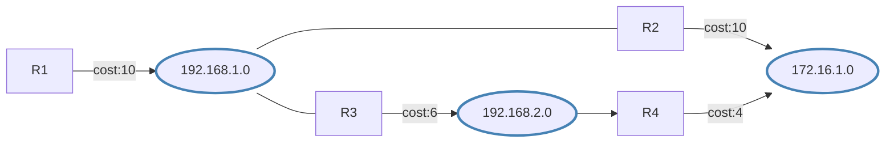
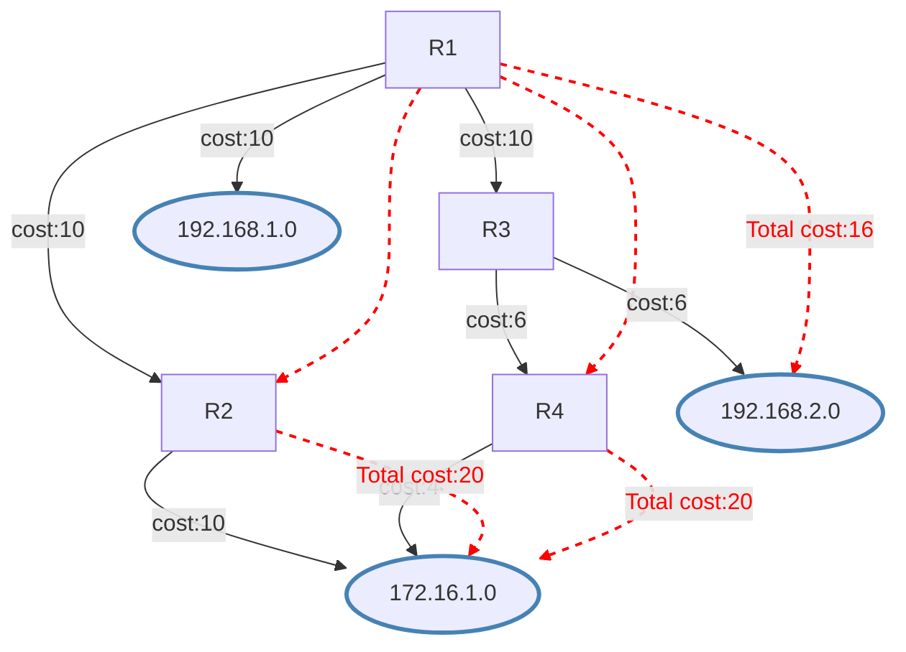

鏈路狀態資料庫描述了路由器以及互連這些路由器並適合用於轉發的鏈路。它還包含每條鏈路的開銷（度量值）。該度量值用於計算通往目標網路的最短路徑。

每臺路由器可以為其自身的鏈路方向通告不同的開銷。這會形成非對稱鏈路：發往目標的封包沿一條路徑傳輸，而響應則沿另一條路徑傳輸。非對稱路徑會使故障排查變得複雜。
在 [`/routing/ospf/interface-template`](../../../../cli-reference/routing/ospf/interface-template.md) 選單中更改開銷值，或在 [`/routing/ospf/interface`](../../../../cli-reference/routing/ospf/interface.md) 選單中建立靜態 OSPF 介面。例如，要匹配 ether2 介面並將開銷設定為 100：

```ros
/routing/ospf/interface-template
add interfaces=ether2 cost=100 area=backbone_v2
```

Cisco 路由器上介面的開銷與該介面的頻寬成反比。頻寬越高表示開銷越低。如果 RouterOS 上需要類似的開銷，請使用公式 `Cost = 100000000/bw_in_bps`。

OSPF 路由器使用 Dijkstra 最短路徑優先（SPF）演算法來計算最短路徑。該演算法將路由器置於樹的根節點，並根據到達目標所需的累積開銷計算到每個目標的最短路徑。即使所有路由器使用相同的鏈路狀態資料庫，每臺路由器也會計算自己的樹。

## SPT 計算 {#spt-calculation}

假設有以下網路。該網路由 4 臺路由器組成。出介面的 OSPF 開銷顯示在表示鏈路的線附近。要為路由器 R1 構建最短路徑樹，請將 R1 作為根，並計算每個目標的最小開銷。



已找到通往 172.16.1.0 網路的多條最短路徑。這允許對發往目標的流量進行負載均衡。此類路由稱為[等價多路徑（ECMP）](../../routing-decision.md#multipath-ecmp-routes)。構建最短路徑樹後，路由器會相應地構建路由表。網路會根據樹中計算出的開銷來訪問。



路由表計算看起來很簡單；然而，當使用某些 OSPF 擴充套件或計算 OSPF 區域時，路由計算會變得更加複雜。

## 轉發地址 {#forwarding-address}

OSPF 路由器可以將 **forwarding-address** 設定為自身以外的地址，表示可以使用備用下一跳。在大多數情況下，轉發地址設定為 **0.0.0.0**，這表示只能透過通告路由器到達該路由。

如果滿足以下條件，則會在 LSA 中設定轉發地址：

- 必須在下一跳介面上啟用 OSPF。
- 下一跳地址落在 OSPF networks 提供的網路中。

接收此類 LSA 的路由器，如果 OSPF 能夠解析該轉發地址，則可以使用該轉發地址。如果無法直接解析轉發地址，路由器會將 LSA 中該轉發地址的下一跳設定為閘道器。如果完全無法解析轉發地址，閘道器將是 originator-id。解析僅透過 OSPF 例項路由進行，而不是使用整個路由表。

考慮以下示例設定：


路由器 **R1** 有一條通往外部網路 _192.168.0.0/24_ 的靜態路由。OSPF 在 R1、R2 和 R3 之間執行，並且該靜態路由被分發到 OSPF 網路中。

這種設定中的問題顯而易見。R2 無法直接到達外部網路。來自 **R2** 發往 LAN 網路的流量將透過路由器 **R1** 轉發，但網路圖顯示 **R2** 可以直接到達連線到 LAN 網路的路由器。

瞭解轉發地址的條件後，你可以讓路由器 **R1** 設定轉發地址。在路由器 **R1** 的配置中，將 10.1.101.0/24 網路新增到 OSPF networks 中：

```ros
/routing/ospf/interface-template add area=backbone_v2 networks=10.1.101.0/24
```

現在驗證轉發地址是否生效：

```ros
[admin@r2] /ip/route> print where dst-address=192.168.0.0/24
Flags: D - DYNAMIC; A - ACTIVE; o, y - COPY
Columns: DST-ADDRESS, GATEWAY, DISTANCE
    DST-ADDRESS       GATEWAY            DISTANCE
DAo 192.168.0.0/24    10.1.101.1%ether1       110

```

在所有 OSPF 路由器上，你將看到 LSA 中設定的轉發地址不是 0.0.0.0。

```ros
[admin@r2] /routing/ospf/lsa> print where id=192.168.0.0
Flags: S - self-originated, F - flushing, W - wraparound; D - dynamic 

 1  D instance=default_ip4 type="external" originator=10.1.101.10 id=192.168.0.0 
      sequence=0x80000001 age=19 checksum=0xF336 body=
        options=E
        netmask=255.255.255.0
        forwarding-address=10.1.101.1
        metric=10 type-1
        route-tag=0
```

:::tip
10.1.101.0/24 網路中的路由器之間不需要建立 OSPF 鄰接關係。
:::
