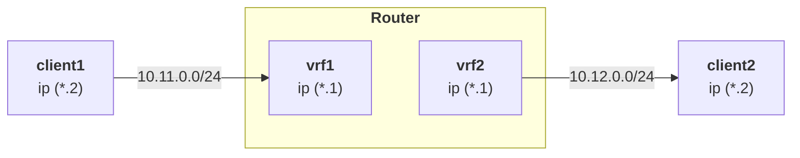
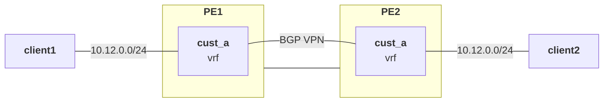

## 描述 {#description}

RouterOS 允許在單臺路由器上建立多個 Virtual Routing and Forwarding（**VRF**）例項。這對於基於 BGP 的 MPLS VPN 很有價值。與 OSI 二層技術的 BGP VPLS 不同，BGP VRF VPN 工作在三層，並在路由器之間交換 IP 字首。VRF 解決了 IP 字首重疊的問題，並透過為不同 VPN 分別路由來提供所需的私密性。

你可以設定 VRF-Lite 配置，或使用帶 VPNv4 地址族的多協定 BGP，將 VRF 路由表中的路由分發到其他路由器，或分發到同一路由器上的不同路由表。

## 配置 {#configuration}

VRF 表在 [**`/ip/vrf`**](../../cli-reference/ip/vrf.md) 選單中建立。建立 VRF 配置後，會新增路由表對映（建立一個同名的動態表）。每個活動 VRF 始終會有一個對映的路由表。

```ros
[admin@arm-bgp] /ip/vrf> print
Flags: X - disabled; * - builtin
 0  * name="main" interfaces=all

[admin@arm-bgp] /routing/table> print
Flags: D - dynamic; X - disabled, I - invalid; U - used
 0 D   name="main" fib

```

新增 VRF 的順序很重要。為了正確匹配介面屬於哪個 VRF，請按正確順序放置 VRF（匹配從頂部條目開始，類似防火牆規則）。

:::info
由於每個 VRF 都有一個對映的路由表，唯一 VRF 的最大數量限制為 1024。
:::

考慮以下示例：

```ros
[admin@arm-bgp] /ip/vrf> print
Flags: X - disabled; * - builtin
 0  * name="main" interfaces=all
 1    name="myVrf" interfaces=lo_vrf
```

由於第一個條目匹配所有介面，第二個 VRF 沒有新增任何介面。要解決此問題，必須更改條目的順序。

```ros
[admin@arm-bgp] /ip/vrf> move 1 0
[admin@arm-bgp] /ip/vrf> print
Flags: X - disabled; * - builtin
 0    name="myVrf" interfaces=lo_vrf
 1  * name="main" interfaces=all
```

分配給 VRF 的介面的直連路由會自動安裝到相應的路由表中。

:::info
當介面被分配給 VRF 時，直連路由會被新增到 VRF 路由表中。然而，RouterOS 服務不會僅僅因為在配置中指定 IP 地址就自動知道要使用哪個 VRF。每個服務都需要 VRF 支援和顯式配置。有關某個服務是否支援 VRF 以及 VRF 配置選項的資訊，請參閱相應服務的文件。
:::

例如，配置 SSH 服務監聽屬於該 VRF 的介面上的連線：

```ros
[admin@arm-bgp] /ip/service> set ssh vrf=myVrf
[admin@arm-bgp] /ip/service> print
Flags: X, I - INVALID
Columns: NAME, PORT, CERTIFICATE, VRF
#   NAME     PORT  CERTIFICATE  VRF
0   telnet     23               main
1   ftp        21
2   www        80               main
3   ssh        22               myVrf
4 X www-ssl   443  none         main
5   api      8728               main
6   winbox   8291               main
7   api-ssl  8729  none         main
```

在 [**`/ip/route`**](../../cli-reference/ip/route/index.md) 選單中新增路由時，透過指定 routing-table 引數來向 VRF 新增路由，並透過在閘道器 IP 後追加 @name 來指示在哪個路由表中解析閘道器：

```ros
/ip/route/add dst-address=192.168.1.0/24 gateway=172.16.1.1@myVrf routing-table=myVrf
```

當顯式將閘道器設定為在另一個 VRF 中解析時，VRF 之間就可能發生流量洩漏，例如：

```ros
# 在 myVrf 中添加路由，但在主表中解析网关
/ip/route/add dst-address=192.168.1.0/24 gateway=172.16.1.1@main routing-table=myVrf

# 在主表中添加路由，但在 myVrf 中解析网关
/ip/route/add dst-address=192.168.1.0/24 gateway=172.16.1.1@myVrf
```

:::info
如果閘道器配置沒有顯式配置要在其中解析的表，則閘道器會在 "main" 表中解析。
:::

## 支援的服務 {#supported-services}

可以將不同服務放入特定的 VRF，服務在該 VRF 中監聽傳入連線或建立傳出連線。預設情況下，所有服務都使用 `main` 表，但你可以透過單獨的 `vrf` 引數，或在 IP 地址末尾使用 "@" 分隔並指定 VRF 名稱來更改這一點。

下面是支援的服務列表。

| 服務 | 支援 | 備註 |
|---|---|---|
| **[BGP](./unicast/bgp/understanding-bgp.md)** | + | <code>/routing/bgp/template add name=bgp-template1 vrf=vrf1</code><br/><code>/routing/bgp/vpls add name=bgp-vpls1 site-id=10 vrf=vrf1</code><br/><code>/routing/bgp/vpn add label-allocation-policy=per-vrf vrf=vrf1</code> |
| **[電子郵件](../../system-information-and-utilities/e-mail.md)** | + | `/tool/e-mail set address=192.168.88.1 vrf=vrf1` |
| **[IP 服務](../../system-information-and-utilities/services.md)** | + | VRF 支援 <code>telnet</code>、<code>www</code>、<code>ssh</code>、<code>www-ssl</code>、<code>api</code>、<code>winbox</code>、<code>api-ssl</code> 服務。<code>ftp</code> 服務不支援更改 VRF。<br/><code>/ip/service/set telnet vrf=vrf1</code> |
| **[L2TP 用戶端](../../virtual-private-networks/l2tp/index.md)** | + | `/interface/l2tp-client add connect-to=192.168.88.1@vrf1 name=l2tp-out1 user=l2tp-client` |
| **[MPLS](./mpls/index.md)** | + | `/mpls/ldp/add vrf=vrf1` |
| **[網路監控](../../diagnostics-monitoring-and-troubleshooting/netwatch.md)** | + | `/tool/netwatch/add host=192.168.88.1@vrf1` |
| **[NTP](../../system-information-and-utilities/ntp.md)** | + | <code>/system/ntp/client/set vrf=vrf1</code><br/><code>/system/ntp/server/set vrf=vrf1</code> |
| **[OSPF](./unicast/ospf/index.md)** | + | `/routing/ospf/instance add disabled=no name=ospf-instance-1 vrf=vrf1` |
| **[ping](../../diagnostics-monitoring-and-troubleshooting/ping.md)** | + | `/ping 192.168.88.1 vrf=vrf1` |
| **[RADIUS](../../authentication-authorization-accounting/radius.md)** | + | <code>/radius/add address=192.168.88.1@vrf1</code><br/><code>/radius/incoming/set vrf=vrf1</code> |
| **[RIP](./unicast/rip.md)** | + | `/routing/rip/instance/add name=rip-instance-1 vrf=vrf1` |
| **[RPKI](./unicast/rpki.md)** | + | `/routing/rpki/add vrf=vrf1` |
| **[SNMP](../../diagnostics-monitoring-and-troubleshooting/snmp.md)** | + | `/snmp/set vrf=vrf1` |
| **[EoIP](../../virtual-private-networks/eoip.md)** | + | `/interface/eoip add remote-address=192.168.1.1@vrf1` |
| **[IPIP](../../virtual-private-networks/ipip.md)** | + | `/interface/ipip/add remote-address=192.168.1.1@vrf1` |
| **[GRE](../../virtual-private-networks/gre.md)** | + | `/interface/gre/add remote-address=192.168.1.1@vrf1` |
| **[SSTP-client](../../virtual-private-networks/sstp.md#sstp-client)** | + | `/interface/sstp-client/add connect-to=192.168.1.1@vrf1` |
| **[OVPN-client](../../virtual-private-networks/openvpn.md#ovpn-client)** | + | `/interface/ovpn-client/add connect-to=192.168.1.1@vrf1` |
| **[L2TP-ether](../../virtual-private-networks/l2tp/index.md#l2tp-ether)** | + | `/interface/l2tp-ether/add connect-to=192.168.2.2@vrf` |
| **[VXLAN](../../bridging-and-switching/vxlan.md)** | + | `/interface/vxlan/add vni=10 vtep-vrf=vrf1` |
| **[獲取](../../system-information-and-utilities/fetch.md)** | + | `/tool/fetch address=10.155.28.236@vrf1 mode=ftp src-path=my_file.pcap user=admin password=""` |
| **[DNS](../../network-management/dns.md)** | + <br/> 從 RouterOS v7.21 開始 | 指定路由器在哪個 VRF 中監聽 DNS 查詢。<br/><code>/ip/dns/set vrf=vrf1</code><br/>指定用於聯絡上游伺服器的 VRF。<br/><code>/ip/dns/set servers=8.8.8.8@vrf1</code> |
| **[DHCP-Relay](../../network-management/dhcp.md)** | + <br/> 從 RouterOS v7.15 開始 | <code>/ip/dhcp-relay/set dhcp-server-vrf=vrf1</code><br/><em>如果 DHCP 用戶端位於同一 VRF 中，則不需要在 "ip dhcp-relay" 配置中設定特殊引數。</em> |
| **[遠端日誌](../../diagnostics-monitoring-and-troubleshooting/log/index.md)** | + <br/> 從 RouterOS v7.19 開始 | `/system/logging/action add name=remote1 remote=192.168.1.1 target=remote vrf=vrf1` |

## 防火牆中的 VRF 介面 {#vrf-interfaces-in-firewall}

:::warning
在 RouterOS v7.14 之前，帶有 in/out-interface 屬性的防火牆過濾規則會應用於 VRF 例項內的介面。從 RouterOS v7.14 開始，這些規則不再針對 VRF 內的單個介面，而是針對整個 VRF 介面。
:::

從 RouterOS v7.14 開始，當介面被新增到 VRF 時，會自動建立一個虛擬 VRF 介面。要匹配屬於某個 VRF 介面的流量，請在防火牆過濾規則中使用該 VRF 虛擬介面，例如：

```ros
/ip/vrf/add interfaces=ether5 name=vrf5
/ip/firewall/filter/add chain=input in-interface=vrf5 action=accept
```

如果多個介面屬於同一個 VRF，但你只需要匹配其中一個介面，請使用連線標記。例如：

```ros
/ip/vrf/add interfaces=ether15,ether16 name=vrf1516
/ip/firewall/mangle
add action=mark-connection chain=prerouting connection-state=new in-interface=ether15 new-connection-mark=input_allow passthrough=yes
/ip/firewall/filter
add action=accept chain=input connection-mark=input_allow
```

## 示例 {#examples}

### 簡單的 VRF-Lite 設定 {#simple-vrf-lite-setup}

考慮這樣一個設定：兩個客戶 VRF 需要訪問網際網路：

```ros
/ip/address
add address=172.16.1.2/24 interface=public
add address=192.168.1.1/24 interface=ether1
add address=192.168.2.1/24 interface=ether2

/ip/route
add gateway=172.16.1.1

# 添加 VRF 配置
/ip/vrf
add name=cust_a interface=ether1 place-before 0
add name=cust_b interface=ether2 place-before 0

# 添加 vrf 路由
/ip/route
add gateway=172.16.1.1@main routing-table=cust_a
add gateway=172.16.1.1@main routing-table=cust_b

# 对本地源进行伪装
/ip/firewall/nat/add chain=srcnat out-interface=public action=masquerade
```

可能需要確保到達 "public" 介面的封包進入正確的 VRF。
這可以透過標記源自 VRF 客戶的新連線，並根據 "public" 介面上傳入封包的路由標記來引導流量來解決。

```ros
# 标记新的客户连接
/ip/firewall/mangle
add action=mark-connection chain=prerouting connection-state=new new-connection-mark=\
    cust_a_conn src-address=192.168.1.0/24 passthrough=no
add action=mark-connection chain=prerouting connection-state=new new-connection-mark=\
    cust_b_conn src-address=192.168.2.0/24 passthrough=no

# 标记路由
/ip/firewall/mangle
add action=mark-routing chain=prerouting connection-mark=cust_a_conn \
    in-interface=public new-routing-mark=cust_a
add action=mark-routing chain=prerouting connection-mark=cust_b_conn \
    in-interface=public new-routing-mark=cust_b
```

### 靜態跨 VRF 路由 {#static-inter-vrf-routes}

通常，應使用 [BGP](./unicast/bgp/understanding-bgp.md) 本地匯入和匯出功能在 VRF 之間交換所有路由。如果這還不夠，可以使用靜態路由來實現所謂的路由洩漏。

可以透過兩種方式安裝一條路由，使其閘道器位於與該路由本身不同的路由表中。

第一種方式是在新增路由時，在 gateway 欄位中顯式指定路由表。只有在將路由和閘道器從 "main" 路由表洩漏到不同路由表（VRF）時才可能這樣做。例如：

```ros
# 在 'vrf1' 路由表中添加通往 5.5.5.0/24 的路由，网关位于主路由表中
add dst-address=5.5.5.0/24 gateway=10.3.0.1@main routing-table=vrf1
```

第二種方式是在 gateway 欄位中顯式指定介面。指定的介面可以屬於某個 VRF 例項。例如：

```ros
# 在主路由表中添加通往 5.5.5.0/24 的路由，网关为 'ether2' VRF 接口
add dst-address=5.5.5.0/24 gateway=10.3.0.1%ether2 routing-table=main
# 在主路由表中添加通往 5.5.5.0/24 的路由，以 'ptp-link-1' VRF 接口作为网关
add dst-address=5.5.5.0/24 gateway=ptp-link-1 routing-table=main
```

可以看出，有兩種變體——將閘道器指定為 *ip\_address%interface*，或僅指定 *interface*。在大多數情況下，對於廣播介面使用第一種方式。對於點對點介面使用第二種方式；如果該路由在某個 VRF 中是直連路由，則對於廣播介面也使用第二種方式。例如，如果介面 *ether2* 上有一個放入 VRF 的地址 `1.2.3.4/24`，那麼該 VRF 的路由表中會存在一條通往 `1.2.3.0/24` 的直連路由。即使 *ether2* 是廣播介面，也可以在不同路由表中新增一條僅以介面作為閘道器的靜態路由 `1.2.3.0/24`：

```ros
add dst-address=1.2.3.0/24 gateway=ether2 routing-table=main

```

### 靜態 VRF-Lite 直連路由洩漏 {#static-vrf-lite-connected-route-leaking}

有時需要從另一個 VRF 訪問直連資源。在此示例中，兩個直連網路各自位於自己的 VRF 中，並且你希望允許 client1 訪問 client2。



```ros
/ip/address
add address=10.11.0.1/24 interface=sfp-sfpplus1
add address=10.12.0.1/24 interface=sfp-sfpplus2

# 添加 VRF 配置
/ip/vrf
add name=vrfTest1 interface=sfp-sfpplus1 place-before 0
add name=vrfTest2 interface=sfp-sfpplus2 place-before 0

```

透過將閘道器設定為 "interface@vrf"，可以在特定 VRF 上訪問直連網路。

```ros
# 添加 vrf 路由
/ip/route
add dst-address=10.11.0.0/24 gateway="sfp-sfpplus1@vrfTest1" routing-table=vrfTest2
add dst-address=10.12.0.0/24 gateway="sfp-sfpplus2@vrfTest2" routing-table=vrfTest1

```

**驗證路由和可達性**

```text
[admin@CCR2004_2XS] /ip/route> print detail
Flags: D - dynamic; X - disabled, I - inactive, A - active;
c - connect, s - static, r - rip, b - bgp, o - ospf, i - is-is, d - dhcp, v - vpn, m - modem, y - bgp-mpls-vpn; H - hw-offloaded; + - ecmp

    DAc   dst-address=10.11.0.0/24 routing-table=vrfTest1 gateway=sfp-sfpplus1@vrfTest1 immediate-gw=sfp-sfpplus1 distance=0 scope=10 suppress-hw-offload=no
          local-address=10.11.0.1%sfp-sfpplus1@vrfTest1

 1  As   dst-address=10.12.0.0/24 routing-table=vrfTest1 pref-src="" gateway=vrfTest2 immediate-gw=vrfTest2 distance=1 scope=30 target-scope=10
          suppress-hw-offload=no

 2  As   dst-address=10.11.0.0/24 routing-table=vrfTest2 pref-src="" gateway=vrfTest1 immediate-gw=vrfTest1 distance=1 scope=30 target-scope=10
          suppress-hw-offload=no

    DAc   dst-address=10.12.0.0/24 routing-table=vrfTest2 gateway=sfp-sfpplus2@vrfTest2 immediate-gw=sfp-sfpplus2 distance=0 scope=10 suppress-hw-offload=no
          local-address=10.12.0.1%sfp-sfpplus2@vrfTest2

```

```text
[admin@cl2] > /ping 10.11.0.2 src-address=10.12.0.2
  SEQ HOST                                     SIZE TTL TIME       STATUS
    0 10.11.0.2                                 56  64 67us
    1 10.11.0.2                                 56  64 61us
    sent=2 received=2 packet-loss=0% min-rtt=61us avg-rtt=64u

```

:::warning
嘗試洩漏重疊網路是行不通的。
:::

**在另一個 VRF 中訪問路由器的本地地址**

```text
[admin@cl2] > /ping 10.11.0.1 src-address=10.12.0.2
  SEQ HOST                                     SIZE TTL TIME       STATUS
    0 10.11.0.1                                                   timeout
    1 10.11.0.1                                                   timeout
    sent=2 received=0 packet-loss=100%

```

使用 "interface@vrf" 閘道器的方法僅在路由器轉發封包時有效。要訪問本地 VRF 地址，需要路由到 VRF 介面。

```ros
# 添加 vrf 路由
/ip/route
add dst-address=10.11.0.0/24 gateway=vrfTest1@vrfTest1 routing-table=vrfTest2
add dst-address=10.12.0.0/24 gateway=vrfTest2@vrfTest2 routing-table=vrfTest1

```

```text
[admin@cl2] > /ping 10.11.0.1 src-address=10.12.0.2
  SEQ HOST                                     SIZE TTL TIME       STATUS
    0 10.11.0.1                                 56  64 67us
    1 10.11.0.1                                 56  64 61us
    sent=2 received=2 packet-loss=0% min-rtt=61us avg-rtt=64u

```

### 動態 VRF-Lite 路由洩漏 {#dynamic-vrf-lite-route-leaking}

在足夠大的設定中，靜態路由洩漏並不夠用。考慮與靜態路由洩漏示例相同的設定，只是額外加入 IPv6 地址，僅用於演示。

```ros
/ip/address
add address=10.11.0.1/24 interface=sfp-sfpplus1
add address=10.12.0.1/24 interface=sfp-sfpplus2

# 添加 VRF 配置
/ip/vrf
add name=vrfTest1 interface=sfp-sfpplus1 place-before 0
add name=vrfTest2 interface=sfp-sfpplus2 place-before 0

/ipv6/address
add address=2001:1::1 advertise=no interface=sfp-sfpplus1
add address=2001:2::1 advertise=no interface=sfp-sfpplus2

```

你可以使用 [BGP VPN](../../cli-reference/routing/bgp/vpn.md) 洩漏本地路由，而無需實際建立 BGP 會話。

```ros
/routing/bgp/vpn
add export.redistribute=connected .route-targets=1:1 import.route-targets=1:2 label-allocation-policy=per-vrf name=bgp-mpls-vpn-1 \
    route-distinguisher=1.2.3.4:1 vrf=vrfTest1
add export.redistribute=connected .route-targets=1:2 import.route-targets=1:1 label-allocation-policy=per-vrf name=bgp-mpls-vpn-2 \
    route-distinguisher=1.2.3.4:1 vrf=vrfTest2
```

:::warning
請小心處理匯入/匯出 route target。如果設定不當，來自同一 VRF 的本地 VRF 路由會被匯入。
:::

現在，VRF 之間的直連路由已交換。

```text
[admin@CCR2004_2XS] > /routing/route/print where dst-address in 111.0.0.0/8 && afi=ip4
...
 Ac   afi=ip4 contribution=active dst-address=111.11.0.0/24 routing-table=vrfTest1 gateway=sfp-sfpplus1@vrfTest1 immediate-gw=sfp-sfpplus1 distance=0 scope=10
       belongs-to="connected" local-address=111.11.0.1%sfp-sfpplus1@vrfTest1
       debug.fwp-ptr=0x202421E0
 Ay   afi=ip4 contribution=best-candidate dst-address=111.12.0.0/24 routing-table=vrfTest1 label=17 gateway=vrfTest2@vrfTest2 immediate-gw=sfp-sfpplus2
       distance=200 scope=40 target-scope=10 belongs-to="bgp-mpls-vpn-1-bgp-mpls-vpn-2-connected-export-import"
       bgp.ext-communities=rt:1:2 .atomic-aggregate=no .origin=incomplete
       debug.fwp-ptr=0x202425A0
 Ay   afi=ip4 contribution=best-candidate dst-address=111.11.0.0/24 routing-table=vrfTest2 label=16 gateway=vrfTest1@vrfTest1 immediate-gw=sfp-sfpplus1
       distance=200 scope=40 target-scope=10 belongs-to="bgp-mpls-vpn-2-bgp-mpls-vpn-1-connected-export-import"
       bgp.ext-communities=rt:1:1 .atomic-aggregate=no .origin=incomplete
       debug.fwp-ptr=0x202424E0
 Ac   afi=ip4 contribution=active dst-address=111.12.0.0/24 routing-table=vrfTest2 gateway=sfp-sfpplus2@vrfTest2 immediate-gw=sfp-sfpplus2 distance=0 scope=10
       belongs-to="connected" local-address=111.12.0.1%sfp-sfpplus2@vrfTest2
       debug.fwp-ptr=0x20242240

```

IPv6 也是如此：

```text
[admin@CCR2004_2XS] /routing/route> print detail where dst-address in 2001::/8 && afi=ip6
...
 Ac   afi=ip6 contribution=active dst-address=2001:1::/64 routing-table=vrfTest1 gateway=sfp-sfpplus1@vrfTest1 immediate-gw=sfp-sfpplus1 distance=0 scope=10
       belongs-to="connected" local-address=2001:1::1%sfp-sfpplus1@vrfTest1
       debug.fwp-ptr=0x20242300
 Ay   afi=ip6 contribution=active dst-address=2001:2::/64 routing-table=vrfTest1 label=17 gateway=vrfTest2@vrfTest2 immediate-gw=sfp-sfpplus2 distance=200
       scope=40 target-scope=10 belongs-to="bgp-mpls-vpn-1-bgp-mpls-vpn-2-connected-export-import"
       bgp.ext-communities=rt:1:2 .atomic-aggregate=no .origin=incomplete
       debug.fwp-ptr=0x202425A0
 Ay   afi=ip6 contribution=active dst-address=2001:1::/64 routing-table=vrfTest2 label=16 gateway=vrfTest1@vrfTest1 immediate-gw=sfp-sfpplus1 distance=200
       scope=40 target-scope=10 belongs-to="bgp-mpls-vpn-2-bgp-mpls-vpn-1-connected-export-import"
       bgp.ext-communities=rt:1:1 .atomic-aggregate=no .origin=incomplete
       debug.fwp-ptr=0x202424E0
 Ac   afi=ip6 contribution=active dst-address=2001:2::/64 routing-table=vrfTest2 gateway=sfp-sfpplus2@vrfTest2 immediate-gw=sfp-sfpplus2 distance=0 scope=10
       belongs-to="connected" local-address=2001:2::1%sfp-sfpplus2@vrfTest2
       debug.fwp-ptr=0x20242360

```

### 動態 VRF-Lite 路由洩漏（舊變通方法） {#dynamic-vrf-lite-route-leaking-old-workaround}

在 RouterOS v7.14 之前，不存在在同一路由器上將路由從一個 VRF 例項洩漏到另一個 VRF 例項的機制。

作為一種變通方法，可以在兩個本地配置的環回地址之間建立隧道，並將每個隧道端點分配到各自的 VRF。隨後，動態路由協定或靜態路由可以在兩個 VRF 之間洩漏路由。

這種方法的缺點是，必須在每一對需要洩漏路由的 VRF 之間建立隧道（形成全互聯），即使只有少量 VRF，也會顯著增加配置複雜性，更不用說更復雜的設定了。

例如，在 5 個 VRF 之間洩漏路由需要 n × (n − 1) / 2 個連線，這會在一臺路由器上產生 20 個隧道端點和 20 個 [OSPF](./unicast/ospf/index.md) 例項。

兩個 VRF 的示例配置：

```ros
/interface/bridge
add name=dummy_custC
add name=dummy_custB
add name=lo1
add name=lo2

/ip/address
add address=111.255.255.1 interface=lo1 network=111.255.255.1
add address=111.255.255.2 interface=lo2 network=111.255.255.2
add address=172.16.1.0/24 interface=dummy_custC network=172.16.1.0
add address=172.16.2.0/24 interface=dummy_custB network=172.16.2.0

/interface/ipip
add local-address=111.255.255.1 name=ipip-tunnel1 remote-address=111.255.255.2
add local-address=111.255.255.2 name=ipip-tunnel2 remote-address=111.255.255.1

/ip/address
add address=192.168.1.1/24 interface=ipip-tunnel1 network=192.168.1.0
add address=192.168.1.2/24 interface=ipip-tunnel2 network=192.168.1.0

/ip/vrf
add interfaces=ipip-tunnel1,dummy_custC name=custC
add interfaces=ipip-tunnel2,dummy_custB name=custB

/routing/ospf/instance
add disabled=no name=i2_custB redistribute=connected,static,copy router-id=192.168.1.1 routing-table=custB vrf=custB
add disabled=no name=i2_custC redistribute=connected router-id=192.168.1.2 routing-table=custC vrf=custC
/routing/ospf/area
add disabled=no instance=i2_custB name=custB_bb
add disabled=no instance=i2_custC name=custC_bb
/routing/ospf/interface-template
add area=custB_bb disabled=no networks=192.168.1.0/24
add area=custC_bb disabled=no networks=192.168.1.0/24

```

**結果**

```ros
[admin@rack1_b36_CCR1009] /routing/ospf/neighbor> print
Flags: V - virtual; D - dynamic
 0  D instance=i2_custB area=custB_bb address=192.168.1.1 priority=128 router-id=192.168.1.2 dr=192.168.1.1 bdr=192.168.1.2
      state="Full" state-changes=6 adjacency=41m28s timeout=33s

 1  D instance=i2_custC area=custC_bb address=192.168.1.2 priority=128 router-id=192.168.1.1 dr=192.168.1.1 bdr=192.168.1.2
      state="Full" state-changes=6 adjacency=41m28s timeout=33s

[admin@rack1_b36_CCR1009] /ip/route> print where routing-table=custB
Flags: D - DYNAMIC; A - ACTIVE; c, s, o, y - COPY
Columns: DST-ADDRESS, GATEWAY, DISTANCE
     DST-ADDRESS       GATEWAY                         DISTANCE
  DAo 172.16.1.0/24     192.168.1.1%ipip-tunnel2@custB       110
  DAc 172.16.2.0/24     dummy_custB@custB                      0
  DAc 192.168.1.0/24    ipip-tunnel2@custB                     0

[admin@rack1_b36_CCR1009] > /ip/route/print where routing-table=custC
Flags: D - DYNAMIC; A - ACTIVE; c, o, y - COPY
Columns: DST-ADDRESS, GATEWAY, DISTANCE
    DST-ADDRESS       GATEWAY                         DISTANCE
  DAc 172.16.1.0/24     dummy_custC@custC                      0
  DAo 172.16.2.0/24     192.168.1.2%ipip-tunnel1@custC       110
  DAc 192.168.1.0/24    ipip-tunnel1@custC                     0

```

### 最簡單的 MPLS VPN 設定 {#the-simplest-mpls-vpn-setup}


在此示例中，建立了一個基本的 [MPLS](./mpls/index.md) 骨幹網路（由兩臺提供商邊緣（PE）路由器 PE1 和 PE2 組成），並配置為在屬於 *cust-one* VPN 的客戶邊緣（CE）路由器 CE1 和 CE2 之間轉發流量。

**CE1 路由器**

```ros
/ip/address/add address=10.1.1.1/24 interface=ether1
# 使用静态路由
/ip/route/add dst-address=10.3.3.0/24 gateway=10.1.1.2
```

**CE2 路由器**

```ros
/ip/address/add address=10.3.3.4/24 interface=ether1
/ip/route/add dst-address=10.1.1.0/24 gateway=10.3.3.3
```

**PE1 路由器**

```ros
/interface/bridge/add name=lobridge
/ip/address/add address=10.1.1.2/24 interface=ether1
/ip/address/add address=10.2.2.2/24 interface=ether2
/ip/address/add address=10.5.5.2/32 interface=lobridge
/ip/vrf/add name=cust-one interfaces=ether1
/mpls/ldp/add enabled=yes transport-address=10.5.5.2 lsr-id=10.5.5.2
/mpls/ldp/interface/add interface=ether2
/routing/bgp/template/set default as=65000

/routing/bgp/vpn
add vrf=cust-one \
  route-distinguisher=1.1.1.1:111 \
  import.route-targets=1.1.1.1:111 \
  import.router-id=cust-one \
  export.redistribute=connected \
  export.route-targets=1.1.1.1:111 \
  label-allocation-policy=per-vrf
/routing/bgp/connection
add template=default remote.address=10.5.5.3 address-families=vpnv4 local.address=10.5.5.2

# 添加通往远程 BGP 对等体 loopback 地址的路由
/ip/route/add dst-address=10.5.5.3/32 gateway=10.2.2.3
```

**PE2 路由器（Cisco）**

```
ip vrf cust-one
rd 1.1.1.1:111
route-target export 1.1.1.1:111
route-target import 1.1.1.1:111
exit

interface Loopback0
ip address 10.5.5.3 255.255.255.255

mpls ldp router-id Loopback0 force
mpls label protocol ldp

interface FastEthernet0/0
ip address 10.2.2.3 255.255.255.0
mpls ip

interface FastEthernet1/0
ip vrf forwarding cust-one
ip address 10.3.3.3 255.255.255.0

router bgp 65000
neighbor 10.5.5.2 remote-as 65000
neighbor 10.5.5.2 update-source Loopback0
address-family vpnv4
neighbor 10.5.5.2 activate
neighbor 10.5.5.2 send-community both
exit-address-family
address-family ipv4 vrf cust-one
redistribute connected
exit-address-family

ip route 10.5.5.2 255.255.255.255 10.2.2.2

```

**結果**

檢查 VPNv4 路由重分發是否正常工作：

```ros
[admin@PE1] /routing/route> print detail where afi="vpn4"
Flags: X - disabled, F - filtered, U - unreachable, A - active;
c - connect, s - static, r - rip, b - bgp, o - ospf, d - dhcp, v - vpn, m - modem, a - ldp-address, l - l
dp-mapping, g - slaac, y - bgp-mpls-vpn;
H - hw-offloaded; + - ecmp, B - blackhole
 Ab   afi=vpn4 contribution=active dst-address=111.16.0.0/24&1.1.1.1:111 routing-table=main label=16
       gateway=111.111.111.4 immediate-gw=111.13.0.2%ether9 distance=200 scope=40 target-scope=30
       belongs-to="bgp-VPN4-111.111.111.4"
       bgp.peer-cache-id=*2C00011 .as-path="65511" .ext-communities=rt:1.1.1.1:111 .local-pref=100
       .atomic-aggregate=yes .origin=igp
       debug.fwp-ptr=0x202427E0

[admin@PE1] /routing/bgp/advertisements> print
 0 peer=to-pe2-1 dst=10.1.1.0/24 local-pref=100 origin=2 ext-communities=rt:1.1.1.1:111 atomic-aggregate=yes

```

檢查 10.3.3.0 是否已安裝到 cust-one 路由表的 IP 路由中：

```ros
[admin@PE1] > /ip/route/print where routing-table="cust-one"
Flags: D - DYNAMIC; A - ACTIVE; c, b, y - BGP-MPLS-VPN
Columns: DST-ADDRESS, GATEWAY, DISTANCE
# DST-ADDRESS     GATEWAY         DISTANCE
0 ADC 10.1.1.0/24 ether1@cust-one        0
1 ADb 10.3.3.0/24 10.5.5.3              20
```

進一步檢視 cust-one VRF 中的 IP 路由可以看出，10.1.1.0/24 IP 字首是某個配置為屬於 cust-one VRF 的介面上的直連路由。10.3.3.0/24 IP 字首由 PE2 透過 BGP 作為 VPNv4 路由通告，並被匯入到此 VRF 路由表中，因為配置的 `import.route-targets` 與該路由通告時攜帶的 BGP 擴充套件社群屬性匹配。

```ros
[admin@PE1] /routing/route> print detail where routing-table="cust-one"
Flags: X - disabled, F - filtered, U - unreachable, A - active;
c - connect, s - static, r - rip, b - bgp, o - ospf, d - dhcp, v - vpn, m - modem, a - ldp-address, l - l
dp-mapping, g - slaac, y - bgp-mpls-vpn;
H - hw-offloaded; + - ecmp, B - blackhole
  Ay   afi=ip4 contribution=active dst-address=10.1.1.0/24 routing-table=cust-one
        gateway=ether1@cust-one immediate-gw=ether1 distance=0 scope=10 belongs-to="connected"
        local-address=10.1.1.2%ether1@cust-one
        debug.fwp-ptr=0x202420C0

 Ay   afi=ip4 contribution=active dst-address=10.3.3.0/24 routing-table=cust-one label=16
        gateway=10.5.5.3 immediate-gw=10.2.2.3%ether2 distance=20 scope=40 target-scope=30
        belongs-to="bgp-mpls-vpn-1-bgp-VPN4-10.5.5.3-import"
        bgp.peer-cache-id=*2C00011 .ext-communities=rt:1.1.1.1:111 .local-pref=100
        .atomic-aggregate=yes .origin=igp
        debug.fwp-ptr=0x20242840

[admin@PE1] /routing/route> print detail where afi="vpn4"
Flags: X - disabled, F - filtered, U - unreachable, A - active;
c - connect, s - static, r - rip, b - bgp, o - ospf, d - dhcp, v - vpn, m - modem, a - ldp-address, l - l
dp-mapping, g - slaac, y - bgp-mpls-vpn;
H - hw-offloaded; + - ecmp, B - blackhole
 Ay   afi=vpn4 contribution=active dst-address=10.1.1.0/24&1.1.1.1:111 routing-table=main label=19
        gateway=ether1@cust-one immediate-gw=ether1 distance=200 scope=40 target-scope=10
        belongs-to="bgp-mpls-vpn-1-connected-export"
        bgp.ext-communities=rt:1.1.1.1:111 .atomic-aggregate=no .origin=incomplete
        debug.fwp-ptr=0x202426C0

 Ab   afi=vpn4 contribution=active dst-address=10.3.3.0/24&1.1.1.1:111 routing-table=main label=16
        gateway=10.5.5.3 immediate-gw=10.2.2.3%ether2 distance=200 scope=40 target-scope=30
        belongs-to="bgp-VPN4-10.5.5.3"
        bgp.peer-cache-id=*2C00011 .ext-communities=rt:1.1.1.1:111 .local-pref=100
        .atomic-aggregate=yes .origin=igp
        debug.fwp-ptr=0x202427E0

```

Cisco 的對應結果：

```
PE2#show ip bgp vpnv4 all
BGP table version is 5, local router ID is 10.5.5.3
Status codes: s suppressed, d damped, h history, * valid, > best, i - internal,
r RIB-failure, S Stale
Origin codes: i - IGP, e - EGP, ? - incomplete
Network Next Hop Metric LocPrf Weight Path
Route Distinguisher: 1.1.1.1:111 (default for vrf cust-one)
*>i10.1.1.0/24 10.5.5.2 100 0 ?
*> 10.3.3.0/24 0.0.0.0 0 32768 ?

PE2#show ip route vrf cust-one
Routing Table: cust-one
Codes: C - connected, S - static, R - RIP, M - mobile, B - BGP
D - EIGRP, EX - EIGRP external, O - OSPF, IA - OSPF inter area
N1 - OSPF NSSA external type 1, N2 - OSPF NSSA external type 2
E1 - OSPF external type 1, E2 - OSPF external type 2
i - IS-IS, su - IS-IS summary, L1 - IS-IS level-1, L2 - IS-IS level-2
ia - IS-IS inter area, * - candidate default, U - per-user static route
o - ODR, P - periodic downloaded static route

Gateway of last resort is not set
10.0.0.0/24 is subnetted, 1 subnets
B 10.1.1.0 [200/0] via 10.5.5.2, 00:05:33
10.0.0.0/24 is subnetted, 1 subnets
C 10.3.3.0 is directly connected, FastEthernet1/0
```

現在你應該能夠從 CE1 ping 到 CE2，反之亦然。

```ros
[admin@CE1] > /ping 10.3.3.4
10.3.3.4 64 byte ping: ttl=62 time=18 ms
10.3.3.4 64 byte ping: ttl=62 time=13 ms
10.3.3.4 64 byte ping: ttl=62 time=13 ms
10.3.3.4 64 byte ping: ttl=62 time=14 ms
4 packets transmitted, 4 packets received, 0% packet loss
round-trip min/avg/max = 13/14.5/18 ms
```

### 更復雜的設定（僅變更部分） {#a-more-complicated-setup-changes-only}


與最簡單的設定不同，此示例有兩個客戶：cust-one 和 cust-two。

為它們配置了兩個 VPN——cust-one 和 cust-two——並且它們之間交換所有路由（這也稱為 "route leaking"）。

這不是最典型的設定，因為不同客戶之間通常不會交換路由。預設情況下，禁止從一個 VRF 站點訪問另一個 VPN 中的不同 VRF 站點（這就是 VPN 的 "Private" 方面）。單獨路由提供了私密性，也是解決 IP 網路字首重疊問題所必需的。路由交換與這兩項要求直接衝突，但有時可能是需要的（例如，當兩個客戶遷移到單一網路基礎設施時作為臨時解決方案）。

**CE1 路由器，*cust-one***

```ros
/ip/route/add dst-address=10.4.4.0/24 gateway=10.1.1.2
```

**CE2 路由器，*cust-one***

```ros
/ip/route/add dst-address=10.4.4.0/24 gateway=10.3.3.3

```

**CE1 路由器，*cust-two***

```ros
/ip/address/add address=10.4.4.5 interface=ether1
/ip/route/add dst-address=10.1.1.0/24 gateway=10.3.3.3
/ip/route/add dst-address=10.3.3.0/24 gateway=10.3.3.3
```

**PE1 路由器**

```ros
# 用以下内容替换旧的 BGP VPN：
/routing/bgp/vpn
add vrf=cust-one \
  export.redistribute=connected \
  route-distinguisher=1.1.1.1:111 \
  import.route-targets=1.1.1.1:111,2.2.2.2:222  \
  export.route-targets=1.1.1.1:111

```

**PE2 路由器（Cisco）**

```
ip vrf cust-one
rd 1.1.1.1:111
route-target export 1.1.1.1:111
route-target import 1.1.1.1:111
route-target import 2.2.2.2:222
exit

ip vrf cust-two
rd 2.2.2.2:222
route-target export 2.2.2.2:222
route-target import 1.1.1.1:111
route-target import 2.2.2.2:222
exit

interface FastEthernet2/0
ip vrf forwarding cust-two
ip address 10.4.4.3 255.255.255.0

router bgp 65000
address-family ipv4 vrf cust-two
redistribute connected
exit-address-family
```

### 變體：用另一臺 MikroTik 替換 Cisco {#variation-replace-the-cisco-with-another-mikrotik}

**PE2 MikroTik 配置**

```ros
/interface/bridge/add name=lobridge
/ip/address
add address=10.2.2.3/24 interface=ether1
add address=10.3.3.3/24 interface=ether2
add address=10.4.4.3/24 interface=ether3
add address=10.5.5.3/32 interface=lobridge
/ip/vrf
add name=cust-one interfaces=ether2
add name=cust-two interfaces=ether3
/mpls/ldp/add enabled=yes transport-address=10.5.5.3
/mpls/ldp/interface/add interface=ether1

/routing/bgp/template/set default as=65000
/routing/bgp/vpn
add vrf=cust-one \
  export.redistribute=connected \
  route-distinguisher=1.1.1.1:111 \
  import.route-targets=1.1.1.1:111,2.2.2.2:222 \
  export.route-targets=1.1.1.1:111 \
add vrf=cust-two \
  export.redistribute=connected \
  route-distinguisher=2.2.2.2:222 \
  import.route-targets=1.1.1.1:111,2.2.2.2:222 \
  export.route-targets=2.2.2.2:222 \

/routing/bgp/connection
add template=default remote.address=10.5.5.2 address-families=vpnv4 local.address=10.5.5.3

# 添加通往远程 BGP 对等体 loopback 地址的路由
/ip/route/add dst-address=10.5.5.2/32 gateway=10.2.2.2

```

**結果**

`/ip/route/print` 的輸出很有意思，值得詳細觀察。

```ros
[admin@PE2] /ip/route> print
Flags: X - disabled, A - active, D - dynamic,
C - connect, S - static, r - rip, b - bgp, o - ospf, m - mme,
B - blackhole, U - unreachable, P - prohibit
# DST-ADDRESS PREF-SRC GATEWAY DISTANCE
0 ADb 10.1.1.0/24 10.5.5.2 recurs... 20
1 ADC 10.3.3.0/24 10.3.3.3 ether2 0
2 ADb 10.4.4.0/24 20
3 ADb 10.1.1.0/24 10.5.5.2 recurs... 20
4 ADb 10.3.3.0/24 20
5 ADC 10.4.4.0/24 10.4.4.3 ether3 0
6 ADC 10.2.2.0/24 10.2.2.3 ether1 0
7 A S 10.5.5.2/32 10.2.2.2 reacha... 1
8 ADC 10.5.5.3/32 10.5.5.3 lobridge 0
```

10.1.1.0/24 路由是從遠端 BGP 對等體接收的，並已安裝到兩個 VRF 路由表中。

10.3.3.0/24 和 10.4.4.0/24 路由也已安裝到兩個 VRF 路由表中。每條路由在一個表中是直連路由，在另一個表中是 BGP 路由。這與它們透過 BGP 通告無關。它們只是被 "通告" 到本地 VPNv4 路由表，隨後在本地重新匯入。匯入和匯出 **route-targets** 決定它們最終會進入哪些表。

這一點從其屬性可以明顯看出——它們沒有通常的 BGP 屬性（路由 10.4.4.0/24）。

```ros
[admin@PE2] /routing/route> print detail where routing-table=cust-one
...

```

### 每站點唯一 RD 與每客戶唯一 RD 對比 {#unique-rd-per-site-vs-unique-rd-per-customer}

考慮一個 BGP VPN 設定，其中兩個 CUST_A 站點通告相同的網路（111.12.0.0/24）。



處理此類設定有兩種方式：

- 每客戶（路由器 1 上的 CUST_A VPN 與路由器 2 上的 CUST_A VPN 具有相同的[路由區分符](./route-distinguisher-and-route-target.md)（假設 RD=1:1））。
- 每站點（每個 CUST_A 站點具有唯一的路由區分符）。

在第一種情況下，Router1 上的 CUST_A 站點已匯出 VPNv4 路由，並將其通告給遠端 PE。

```routeros
 Ay   afi=vpnv4 contribution=active dst-address=111.12.0.0/24&1:1 routing-table=main label=16 gateway=vrf-dummy@vrfTest
       immediate-gw=vrf-dummy distance=200 scope=40 target-scope=10 belongs-to="bgp-mpls-vpn-1-connected-export"
       bgp.ext-communities=rt:1:1 .origin=incomplete
       debug.fwp-ptr=0x20302600
```

Router2 上的 CUST_A 站點也匯出了一條 VPNv4 路由，並且還從另一個站點接收了一條 VPNv4 路由：

```routeros
 Ab + afi=vpnv4 contribution=active dst-address=111.12.0.0/24&1:1 routing-table=main label=16 gateway=111.11.0.2
       immediate-gw=111.11.0.2%sfp-sfpplus1 distance=200 scope=40 target-scope=30 belongs-to="bgp-VPNv4-111.11.0.2"
       bgp.session=to-tested-1 .ext-communities=rt:1:1 .local-pref=100 .origin=igp
       debug.fwp-ptr=0x203421E0

 Ay + afi=vpnv4 contribution=active dst-address=111.12.0.0/24&1:1 routing-table=main label=32 gateway=vrf-dummy@vrfTest
       immediate-gw=vrf-dummy distance=200 scope=40 target-scope=10 belongs-to="bgp-mpls-vpn-1-connected-export"
       bgp.ext-communities=rt:1:1 .origin=incomplete
       debug.fwp-ptr=0x20342540
```

RouterOS 只通告一條最佳路由。在 ECMP 情況下，預設情況下它會選擇列表中的第一條，而這恰好是從遠端站點接收的 BGP VPNv4 路由，遠端站點將不會獲得第二條路由。這會導致一種情況：一個站點在 VRF 中有兩條冗餘路由，而另一個站點沒有。在 VRF 未安裝該 VPN 路由且本地路由變為非活動的站點上，BGP 需要傳送撤銷、重新計算 main 表、從遠端站點接收更新，並將新的最佳路由匯入 CUST_A VRF，從而導致收斂變慢。

可以透過[路由選擇過濾器](./route-selection-and-filtering.md)更改此行為，但這超出了本示例的範圍。

如果匯出到 VPNv4 的路由同時也是從客戶 CE-PE 會話接收的 BGP 路由，則會出現類似情況，只不過這裡不是 ECMP，而是對 VPNv4 路由應用 BGP 最佳路徑選擇過程，並且只選擇一條最佳路由。

如果為每個站點分配唯一的路由區分符（例如，第一個站點為 1.1.1.1:1，第二個站點為 1.1.1.2:1），則 VPNv4 路由不再需要進行選擇，因為它們現在被視為唯一目的地，並且兩者都會被匯入 VRF。

**Router1 上的 CUST_A**

```routeros
[admin@CCR2004_2XS_111] /routing/route> print detail
...
 Ay   afi=vpnv4 contribution=active dst-address=111.12.0.0/24&1.1.1.1:1 routing-table=main label=17 gateway=vrf-dummy@vrfTest
       immediate-gw=vrf-dummy distance=200 scope=40 target-scope=10 belongs-to="bgp-mpls-vpn-1-connected-export"
       bgp.ext-communities=rt:1:1 .origin=incomplete
       debug.fwp-ptr=0x20302240

 Ab   afi=vpnv4 contribution=active dst-address=111.12.0.0/24&1.1.1.2:1 routing-table=main label=33 gateway=111.11.0.1
       immediate-gw=111.11.0.1%sfp-sfpplus1 distance=200 scope=40 target-scope=30 belongs-to="bgp-VPNv4-111.11.0.1"
       bgp.session=to-tester-1 .ext-communities=rt:1:1 .local-pref=100 .origin=igp
       debug.fwp-ptr=0x20302480

[admin@CCR2004_2XS_111] /ip/route> print
...
  DAc  111.12.0.0/24       vrf-dummy@vrfTest  vrfTest               0
  D y  111.12.0.0/24       111.11.0.1         vrfTest             200
```

**Router2 上的 CUST_A**

```routeros
[admin@CCR2004_2XS_111] /routing/route> print detail
...
 Ab   afi=vpnv4 contribution=active dst-address=111.12.0.0/24&1.1.1.1:1 routing-table=main label=17 gateway=111.11.0.2
       immediate-gw=111.11.0.2%sfp-sfpplus1 distance=200 scope=40 target-scope=30 belongs-to="bgp-VPNv4-111.11.0.2"
       bgp.session=to-tested-1 .ext-communities=rt:1:1 .local-pref=100 .origin=igp
       debug.fwp-ptr=0x203421E0

 Ay   afi=vpnv4 contribution=active dst-address=111.12.0.0/24&1.1.1.2:1 routing-table=main label=33 gateway=vrf-dummy@vrfTest
       immediate-gw=vrf-dummy distance=200 scope=40 target-scope=10 belongs-to="bgp-mpls-vpn-1-connected-export"
       bgp.ext-communities=rt:1:1 .origin=incomplete
       debug.fwp-ptr=0x20342240

[admin@CCR2004_2XS_111] /ip/route> print
...
 DAc 111.12.0.0/24       vrf-dummy@vrfTest  vrfTest               0
 D y 111.12.0.0/24       111.11.0.2         vrfTest             200
```

在這種情況下，與之前的設定相比，當任一站點中的本地路由變為非活動狀態時，會立即切換到備用路由。

## 參考資料 {#references}

[RFC 4364：BGP/MPLS IP 虛擬專用網路（VPN）](http://www.ietf.org/rfc/rfc4364.txt)

《MPLS Fundamentals》，第 7 章，*Luc De Ghein*，Cisco Press 2006
