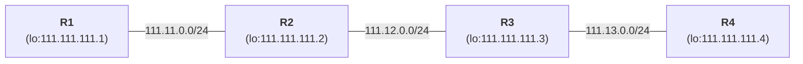

MikroTik RouterOS 為 IPv4 和 IPv6 地址族實現了 Label Distribution Protocol（RFC 3036、RFC 5036 和 RFC 7552）。LDP 是一種協定，它執行一組過程和訊息交換，標籤交換路由器（LSR）透過這些過程和訊息，將網路層路由資訊直接對映到資料鏈路層交換路徑，從而在網路中建立標籤交換路徑（LSP）。

## MPLS 前提條件 {#prerequisites-for-mpls}

### “Loopback” IP 地址 {#loopback-ip-address}

儘管不是嚴格要求，但建議為參與 MPLS 網路的路由器配置“loopback”IP 地址（不附加到任何真實網路介面），供 LDP 用於建立會話。

這有兩個目的：

- 由於任意 2 臺路由器之間只有一個 LDP 會話，無論它們之間有多少條鏈路連線，loopback IP 地址都能確保 LDP 會話不受介面狀態或地址變化的影響。
- 使用 loopback 地址作為 LDP 傳輸地址，可確保在封包上附加多個標籤時（如 VPLS 的情況）具有正確的倒數第二跳彈出行為。

在 RouterOS 中，可以透過建立一個沒有任何埠的虛擬 bridge 介面並向其新增地址來配置“loopback”IP 地址。例如：

```ros
/interface/bridge/add name=lo
/ip/address/add address=10.255.255.1/32 interface=lo
```

### IP 連通性 {#ip-connectivity}

由於 LDP 為活動路由分發標籤，基本要求是正確配置 IP 路由。預設情況下，LDP 為活動的 IGP 路由（即直連路由、靜態路由以及路由協定學習到的路由，BGP 除外）分發標籤。

有關如何正確設定 IGP 的說明，請參閱相應的文件章節：

- [OSPF](../unicast/ospf/index.md)
- [靜態路由](../routing-decision.md)
- 等

LDP 支援 ECMP 路由。

在繼續 LDP 配置之前，應該能夠從網路的任何位置訪問任何 loopback 地址。可以使用 ping 工具從 loopback 地址到 loopback 地址驗證連通性。

## 示例設定 {#example-setup}

假設我們已經設定好四臺現有路由器，並且 IP 連通性正常工作。



### IP 可達性 {#ip-reachability}

這裡不深入介紹路由設定，以下是 IP 和 OSPF 配置的快速匯出：

```ros
#R1
/interface/bridge
add name=loopback
/ip/address
add address=111.11.0.1/24 interface=ether2
add address=111.111.111.1 interface=loopback

/routing/ospf/instance
add name=default_ip4 router-id=111.111.111.1
/routing/ospf/area
add instance=default_ip4 name=backbone_ip4
/routing/ospf/interface-template
add area=backbone_ip4 dead-interval=10s hello-interval=1s networks=111.111.111.1 
add area=backbone_ip4 dead-interval=10s hello-interval=1s networks=111.11.0.0/24 

#R2
/interface/bridge
add name=loopback
/ip/address
add address=111.11.0.2/24 interface=ether2
add address=111.12.0.1/24 interface=ether3
add address=111.111.111.2 interface=loopback

/routing/ospf/instance
add name=default_ip4 router-id=111.111.111.2
/routing/ospf/area
add instance=default_ip4 name=backbone_ip4
/routing/ospf/interface-template
add area=backbone_ip4 dead-interval=10s hello-interval=1s networks=111.111.111.2
add area=backbone_ip4 dead-interval=10s hello-interval=1s networks=111.11.0.0/24
add area=backbone_ip4 dead-interval=10s hello-interval=1s networks=111.12.0.0/24

#R3
/interface/bridge
add name=loopback

/ip/address
add address=111.12.0.2/24 interface=ether2
add address=111.13.0.1/24 interface=ether3
add address=111.111.111.3 interface=loopback

/routing/ospf/instance
add name=default_ip4 router-id=111.111.111.3
/routing/ospf/area
add instance=default_ip4 name=backbone_ip4
/routing/ospf/interface-template
add area=backbone_ip4 dead-interval=10s hello-interval=1s networks=111.111.111.3
add area=backbone_ip4 dead-interval=10s hello-interval=1s networks=111.12.0.0/24
add area=backbone_ip4 dead-interval=10s hello-interval=1s networks=111.13.0.0/24

#R4
/interface/bridge
add name=loopback
/ip/address
add address=111.13.0.2/24 interface=ether2
add address=111.111.111.4 interface=loopback

/routing/ospf/instance
add name=default_ip4 router-id=111.111.111.4
/routing/ospf/area
add instance=default_ip4 name=backbone_ip4
/routing/ospf/interface-template
add area=backbone_ip4 dead-interval=10s hello-interval=1s networks=111.111.111.4
add area=backbone_ip4 dead-interval=10s hello-interval=1s networks=111.13.0.0/24

```

驗證 IP 連通性和路由是否正常工作

```text
[admin@R4] /ip/address> /tool/traceroute 111.111.111.1 src-address=111.111.111.4
Columns: ADDRESS, LOSS, SENT, LAST, AVG, BEST, WORST, STD-DEV
#  ADDRESS        LOSS  SENT  LAST   AVG  BEST  WORST  STD-DEV
1  111.13.0.1     0%       4  0.6ms  0.6  0.6   0.6    0      
2  111.12.0.1     0%       4  0.5ms  0.6  0.5   0.6    0.1    
3  111.111.111.1  0%       4  0.6ms  0.6  0.6   0.6    0      

```

### LDP 設定 {#ldp-setup}

為了開始分發標籤，在連線其他 LDP 路由器的介面上啟用 LDP，而在連線客戶網路的介面上不啟用 LDP。

在 R1 上，配置如下所示：

```ros
/mpls/ldp
add afi=ip lsr-id=111.111.111.1 transport-addresses=111.111.111.1
/mpls/ldp/interface
add interface=ether2    

```

:::info
請注意，傳輸地址被設定為 111.111.111.1。這使路由器使用此地址發起 LDP 會話連線，並將此地址作為傳輸地址通告給 LDP 鄰居。
:::

其他路由器的設定類似。

R2:

```ros
/mpls/ldp
add afi=ip lsr-id=111.111.111.2 transport-addresses=111.111.111.2
/mpls/ldp/interface
add interface=ether2   
add interface=ether3   

```

在 R3 上：

```ros
/mpls/ldp
add afi=ip lsr-id=111.111.111.3 transport-addresses=111.111.111.3
/mpls/ldp/interface
add interface=ether2   
add interface=ether3   

```

在 R4 上：

```ros
/mpls/ldp
add afi=ip lsr-id=111.111.111.4 transport-addresses=111.111.111.4
/mpls/ldp/interface
add interface=ether2   

```

LDP 會話建立後，R2 應該有兩個 LDP 鄰居：

```text
[admin@R2] /mpls/ldp/neighbor> print 
Flags: D, I - INACTIVE; O, T - THROTTLED; p - PASSIVE
Columns: TRANSPORT, LOCAL-TRANSPORT, PEER, ADDRESSES
#     TRANSPORT      LOCAL-TRANSPORT  PEER             ADDRESSES    
0 DO  111.111.111.1  111.111.111.2    111.111.111.1:0  111.11.0.1   
                                                       111.111.111.1
1 DOp 111.111.111.3  111.111.111.2    111.111.111.3:0  111.12.0.2   
                                                       111.13.0.1   
                                                       111.111.111.3
```

本地對映表顯示哪個標籤被分配給哪條路由，以及路由器已將標籤分發給了哪些對等體。

```text
[admin@R2] /mpls/ldp/local-mapping> print 
Flags: I - INACTIVE; D - DYNAMIC; E - EGRESS; G - GATEWAY; L - LOCAL
Columns: VRF, DST-ADDRESS, LABEL, PEERS
#       VRF   DST-ADDRESS      LABEL      PEERS          
0  D G  main  10.0.0.0/8       16         111.111.111.1:0
                                          111.111.111.3:0
1 IDE L main  10.155.130.0/25  impl-null  111.111.111.1:0
                                          111.111.111.3:0
2 IDE L main  111.11.0.0/24    impl-null  111.111.111.1:0
                                          111.111.111.3:0
3 IDE L main  111.12.0.0/24    impl-null  111.111.111.1:0
                                          111.111.111.3:0
4 IDE L main  111.111.111.2    impl-null  111.111.111.1:0
                                          111.111.111.3:0
5  D G  main  111.111.111.1    17         111.111.111.1:0
                                          111.111.111.3:0
6  D G  main  111.111.111.3    18         111.111.111.1:0
                                          111.111.111.3:0
7  D G  main  111.111.111.4    19         111.111.111.1:0
                                          111.111.111.3:0
8  D G  main  111.13.0.0/24    20         111.111.111.1:0
                                          111.111.111.3:0

```

另一方面，遠端對映表顯示相鄰 LDP 路由器為路由分配的標籤，以及向此路由器通告的標籤：

```text
[admin@R2] /mpls/ldp/remote-mapping> print 
Flags: I - INACTIVE; D - DYNAMIC
Columns: VRF, DST-ADDRESS, NEXTHOP, LABEL, PEER
 #    VRF   DST-ADDRESS      NEXTHOP     LABEL      PEER           
 0 ID main  10.0.0.0/8                   16         111.111.111.1:0
 1 ID main  10.155.130.0/25              impl-null  111.111.111.1:0
 2 ID main  111.11.0.0/24                impl-null  111.111.111.1:0
 3 ID main  111.12.0.0/24                17         111.111.111.1:0
 4  D main  111.111.111.1    111.11.0.1  impl-null  111.111.111.1:0
 5 ID main  111.111.111.2                19         111.111.111.1:0
 6 ID main  111.111.111.3                20         111.111.111.1:0
 7 ID main  111.111.111.4                21         111.111.111.1:0
 8 ID main  111.13.0.0/24                18         111.111.111.1:0
 9 ID main  0.0.0.0/0                    impl-null  111.111.111.3:0
10 ID main  111.111.111.2                16         111.111.111.3:0
11 ID main  111.111.111.1                18         111.111.111.3:0
12  D main  111.111.111.3    111.12.0.2  impl-null  111.111.111.3:0
13  D main  111.111.111.4    111.12.0.2  19         111.111.111.3:0
14 ID main  10.155.130.0/25              impl-null  111.111.111.3:0
15 ID main  111.11.0.0/24                17         111.111.111.3:0
16 ID main  111.12.0.0/24                impl-null  111.111.111.3:0
17  D main  111.13.0.0/24    111.12.0.2  impl-null  111.111.111.3:0

```

我們可以觀察到，該路由器已從其兩個鄰居 R1 和 R3 收到了所有路由的標籤繫結。

遠端對映表只為具有直接下一跳的目標擁有活動對映，例如，讓我們更仔細地檢視 111.111.111.4 的對映。路由表表明，網路 111.111.111.4 可透過 111.12.0.2 (R3) 到達：

```text
[admin@R2] /ip/route> print where dst-address=111.111.111.4
Flags: D - DYNAMIC; A - ACTIVE; o, y - COPY
Columns: DST-ADDRESS, GATEWAY, DISTANCE
    DST-ADDRESS       GATEWAY            DISTANCE
DAo 111.111.111.4/32  111.12.0.2%ether3       110
```

如果再次檢視遠端對映表，唯一的活動對映是從 R3 收到的、分配了標籤 19 的對映。這意味著當 R2 將流量路由到該網路時，將壓入標籤 19。

```text
17  D main  111.111.111.4    111.12.0.2  19         111.111.111.3:0
```

標籤交換規則可以在轉發表中看到：

```text
[admin@R2] /mpls/forwarding-table> print 
Flags: L, V - VPLS
Columns: LABEL, VRF, PREFIX, NEXTHOPS
#   LABEL  VRF   PREFIX         NEXTHOPS                                            
0 L    16  main  10.0.0.0/8     { nh=10.155.130.1; interface=ether1 }               
1 L    18  main  111.111.111.3  { label=impl-null; nh=111.12.0.2; interface=ether3 }
2 L    19  main  111.111.111.4  { label=19; nh=111.12.0.2; interface=ether3 }       
3 L    20  main  111.13.0.0/24  { label=impl-null; nh=111.12.0.2; interface=ether3 }
4 L    17  main  111.111.111.1  { label=impl-null; nh=111.11.0.1; interface=ether2 }
```

如果檢視第 2 條規則，該規則表明當 R2 收到帶有標籤 19 的封包時，它會將標籤更改為新標籤 19（由 R3 分配）。

從這個示例可以看出，路徑上的標籤不必唯一。

現在，如果我們檢視 R3 的轉發表：

```text
[admin@R3] /mpls/forwarding-table> print 
Flags: L, V - VPLS
Columns: LABEL, VRF, PREFIX, NEXTHOPS
#   LA  VRF   PREFIX         NEXTHOPS                                            
0 L 19  main  111.111.111.4  { label=impl-null; nh=111.13.0.2; interface=ether3 }
1 L 17  main  111.11.0.0/24  { label=impl-null; nh=111.12.0.1; interface=ether2 }
2 L 16  main  111.111.111.2  { label=impl-null; nh=111.12.0.1; interface=ether2 }
3 L 18  main  111.111.111.1  { label=17; nh=111.12.0.1; interface=ether2 } 
```

第 0 條規則顯示出標籤為“**impl-null**”。原因是 R3 是到達 111.111.111.4 之前的最後一跳，不需要交換為任何真實標籤。已知 R4 是 111.111.111.4 網路的出口點（對於直連網路，該路由器是出口點，因為流量的下一跳不是 MPLS 路由器），因此它為這條路由通告“implicit null”標籤。這告訴 R3 將目標 111.111.111.4/32 的流量以不帶標籤的方式轉發給 R4，這正是 R3 轉發表條目所表明的。

:::warning
當標籤不交換為任何真實標籤時的動作稱為 **Penultimate hop popping**（倒數第二跳彈出）。它確保在預先知道路由器將必須對封包進行路由時，路由器不必進行不必要的標籤查詢。
:::

## 在 MPLS 網路中使用 traceroute {#using-traceroute-in-mpls-networks}

RFC4950 為 MPLS 引入了 ICMP 協定擴充套件。其基本思想是，某些 ICMP 訊息可能攜帶 MPLS“label stack object”（當封包引發特定 ICMP 訊息時，該封包上的標籤列表）。與 MPLS 相關的 ICMP 訊息是 Time Exceeded 和 Fragmentation Needed。

MPLS 標籤不僅攜帶標籤值，還攜帶 TTL 欄位。當為 IP 封包壓入標籤時，MPLS TTL 被設定為 IP 頭中的值。當從 IP 封包中移除最後一個標籤時，IP TTL 被設定為 MPLS TTL 中的值。因此，可以透過支援 MPLS 擴充套件的 traceroute 工具來診斷 MPLS 交換網路。

例如，從 R1 到 R4 的 traceroute 如下所示：

```text
[admin@R1] /mpls/ldp/neighbor> /tool/traceroute 111.111.111.4 src-address=111.111.111.1
Columns: ADDRESS, LOSS, SENT, LAST, AVG, BEST, WORST, STD-DEV, STATUS
#  ADDRESS        LOSS  SENT  LAST   AVG  BEST  WORST  STD-DEV  STATUS         
1  111.11.0.2     0%       2  0.7ms  0.7  0.7   0.7          0  <MPLS:L=19,E=0>
2  111.12.0.2     0%       2  0.4ms  0.4  0.4   0.4          0  <MPLS:L=19,E=0>
3  111.111.111.4  0%       2  0.5ms  0.5  0.5   0.5          0 
```

Traceroute 結果顯示了封包產生 ICMP Time Exceeded 時其上的 MPLS 標籤。以上內容意味著，當 R3 收到 MPLS TTL 為 1 的封包時，該封包上帶有標籤 19。這與 R3 為 111.111.111.4 通告的標籤相匹配。以同樣的方式，R2 在下一次 traceroute 迭代中觀察到封包上的標籤 19——如上所述，R2 將標籤 19 交換為標籤 19。R4 收到了不帶標籤的封包——如上所述，R3 執行了倒數第二跳彈出。

### 在 MPLS 網路中使用 traceroute 的缺點 {#drawbacks-of-using-traceroute-in-mpls-network}

#### 標籤交換 ICMP 錯誤 {#label-switching-icmp-errors}

在 MPLS 網路中使用 traceroute 的缺點之一是 MPLS 處理所產生的 ICMP 錯誤的方式。在 IP 網路中，ICMP 錯誤只是被路由回引發該錯誤的封包源。在 MPLS 網路中，產生錯誤訊息的路由器甚至可能沒有到達該 IP 封包源的路由（例如，在非對稱標籤交換路徑或某種 MPLS 隧道的情況下，例如傳輸 MPLS VPN 流量）。

因此，產生的 ICMP 錯誤不會被路由到引發錯誤的封包源，而是沿標籤交換路徑繼續交換，假設當標籤交換路徑端點收到 ICMP 錯誤時，它將知道如何正確地將其路由回源。

這導致在 MPLS 網路中無法像在 IP 網路中那樣使用 traceroute——用於確定網路中的故障點。如果標籤交換路徑在中間任何位置斷開，將不會有 ICMP 回覆返回，因為它們無法到達標籤交換路徑的遠端端點。

#### 倒數第二跳彈出與 traceroute 源地址 {#penultimate-hop-popping-and-traceroute-source-address}

要理解並避免倒數第二跳彈出給 traceroute 帶來的問題，需要透徹理解倒數第二跳行為和路由。

在示例設定中，從 R5 到 R1 的常規 traceroute 將產生以下結果：

```
[admin@R5] > /tool/traceroute 9.9.9.1
     ADDRESS                                    STATUS
   1         0.0.0.0 timeout timeout timeout
   2         2.2.2.2 37ms 4ms 4ms
                      mpls-label=17
   3         9.9.9.1 4ms 2ms 11ms

```

與以下結果相比：

```
[admin@R5] > /tool/traceroute 9.9.9.1 src-address=9.9.9.5
     ADDRESS                                    STATUS
   1         4.4.4.3 15ms 5ms 5ms
                      mpls-label=17
   2         2.2.2.2 5ms 3ms 6ms
                      mpls-label=17
   3         9.9.9.1 6ms 3ms 3ms

```

第一次 traceroute 沒有從 R3 獲得響應的原因是，預設情況下，R5 上的 traceroute 使用源地址 4.4.4.5 進行探測，因為它是可到達 9.9.9.1/32 下一跳的路由的首選源地址：

```
[admin@R5] > /ip/route/print
Flags: X - disabled, A - active, D - dynamic,
C - connect, S - static, r - rip, b - bgp, o - ospf, m - mme,
B - blackhole, U - unreachable, P - prohibit
 #      DST-ADDRESS        PREF-SRC        G GATEWAY         DISTANCE             INTERFACE
 ...
 3 ADC  4.4.4.0/24         4.4.4.5                           0                    ether1
 ...
 5 ADo  9.9.9.1/32                         r 4.4.4.3         110                  ether1
 ...

```

當第一個 traceroute 探測被髮送時（源：4.4.4.5，目標 9.9.9.1），R3 會丟棄它併產生一條 ICMP 錯誤訊息（源 4.4.4.3，目標 4.4.4.5），該訊息一路交換到 R1。然後 R1 發回一條 ICMP 錯誤——它沿著標籤交換路徑交換到 4.4.4.5。

R2 是網路 4.4.4.0/24 的倒數第二跳彈出路由器，因為 4.4.4.0/24 直連到 R3。因此，R2 移除最後一個標籤，並將 ICMP 錯誤以不帶標籤的方式傳送給 R3：

```
[admin@R2] > /mpls/forwarding-table/print
 # IN-LABEL             OUT-LABELS           DESTINATION        INTERFACE            NEXTHOP
 ...
 3 19                                        4.4.4.0/24         ether2               2.2.2.3
 ...

```

R3 丟棄收到的 IP 封包，因為它收到一個以自身地址作為源地址的封包。後續探測產生的 ICMP 錯誤會正確返回，因為 R3 收到源地址為 2.2.2.2 和 9.9.9.1 的不帶標籤封包，這些地址對路由器來說是可接受的。

命令：

```
[admin@R5] > /tool/traceroute 9.9.9.1 src-address=9.9.9.5
 ...

```

會產生預期結果，因為 traceroute 探測的源地址是 9.9.9.5。當 ICMP 錯誤從 R1 返回 R5 時，9.9.9.5/32 網路的倒數第二跳彈出發生在 R3，因此它永遠不會路由一個以自身地址作為源地址的封包。

## 最佳化標籤分發 {#optimizing-label-distribution}

### 標籤繫結過濾 {#label-binding-filtering}

在實施給定示例設定的過程中，已經明確並非所有標籤繫結都是必要的。例如，R1 和 R3 或 R2 和 R4 之間沒有必要交換 IP 路由標籤繫結，因為它們沒有機會被使用。此外，如果給定的網路核心僅為此前提到的客戶乙太網網段提供連通性，那麼為路由器之間互連的網路分發標籤就沒有實際用途。唯一重要的路由是到端點或所連線客戶網路的 /32 路由。

標籤繫結過濾可用於僅分發指定的標籤集，以減少資源使用和網路負載。

標籤繫結過濾器有 2 種類型：

- 應在 `/mpls/ldp/advertise-filter` 選單中配置向 LDP 鄰居通告哪些標籤繫結。
- 應在 `/mpls/ldp/accept-filter` 選單中配置從 LDP 鄰居接受哪些標籤繫結。

過濾器按有序列表組織，其中指定必須包含被測試字首的字首，以及鄰居（或萬用字元）。

在給定的示例設定中，可以將所有路由器配置為僅對能夠到達隧道端點的路由通告標籤。為此，需要在所有路由器上配置 2 個通告過濾器：

```ros
/mpls/ldp/advertise-filter/add prefix=111.111.111.0/24 advertise=yes
/mpls/ldp/advertise-filter/add prefix=0.0.0.0/0 advertise=no
```

此過濾器使路由器僅通告被 111.111.111.0/24 字首包含的路由的繫結，該字首涵蓋 loopback（111.111.111.1/32、111.111.111.2/32 等）。第二條規則是必要的，因為當沒有規則匹配時，預設過濾結果是允許相關操作。

在給定設定中，無需設定接受過濾器，因為按照上述 2 條規則引入的約定，沒有 LDP 路由器會分發不必要的繫結。

請注意，過濾器更改不會影響現有對映，因此要使過濾器生效，需要重設鄰居之間的連線，可以透過從 LDP 鄰居表中移除鄰居或重新啟動 LDP 例項來實現。

因此，例如在 R2 上，我們得到：

```text
[admin@R2] /mpls/ldp/remote-mapping> print 
Flags: I - INACTIVE; D - DYNAMIC
Columns: VRF, DST-ADDRESS, NEXTHOP, LABEL, PEER
#    VRF   DST-ADDRESS    NEXTHOP     LABEL      PEER           
0 ID main  111.111.111.2              17         111.111.111.3:0
1 ID main  111.111.111.1              16         111.111.111.3:0
2  D main  111.111.111.3  111.12.0.2  impl-null  111.111.111.3:0
3  D main  111.111.111.4  111.12.0.2  18         111.111.111.3:0
4 ID main  111.111.111.2              16         111.111.111.1:0
5  D main  111.111.111.1  111.11.0.1  impl-null  111.111.111.1:0
6 ID main  111.111.111.3              17         111.111.111.1:0
7 ID main  111.111.111.4              18         111.111.111.1:0
```

## IPv6 和雙棧鏈路上的 LDP {#ldp-on-ipv6-and-dual-stack-links}

RouterOS 實現 RFC 7552，以支援雙棧鏈路上的 LDP。

支援的 AFI 可以由 LDP 例項選擇，也可以按 LDP 介面顯式配置。

```ros
/mpls/ldp
add afi=ip,ipv6 lsr-id=111.111.111.1 preferred-afi=ipv6
/mpls/ldp/interface
add interface=ether2 afi=ip
add interface=ether3 afi=ipv6
```

上述示例使 LDP 例項能夠使用 IPv4 和 IPv6 地址族，並透過 `preferred-afi` 引數將首選項設定為 IPv6。另一方面，LDP 介面配置顯式設定 **ether2** 僅支援 IPv4，**ether3** 僅支援 IPv6。

主要問題是，當混合使用不同 AFI 時如何選擇 AFI，以及如果其中一個受支援的 AFI 發生翻轉（flap）會怎樣。

傳送 hello 的邏輯如下：

- 如果介面只有一個 AFI：
  - 不傳送雙棧元素。
  - 僅當介面上有來自相應 AFI 的 IP 地址時才傳送 hello。
- 如果介面同時具有兩個 AFI：
  - 始終傳送雙棧元素，其中包含來自 preferred-afi 的值。
  - 如果介面上存在相應地址，則在每個 AFI 上傳送 hello。

對等體從所有收到的 hello 中確定使用哪個 AFI 進行連線，以及為哪些 AFI 繫結和傳送標籤。為了使 LDP 能夠使用特定 AFI，必須收到該特定 AFI 的 hello。Hello 封包包含正常 LDP 操作所需的傳輸地址。透過比較收到的 AFI 地址，確定主動/被動角色。

接收和處理 hello 的邏輯如下：

- 如果 LDP 例項只有一個 AFI（這意味著所有介面只能執行該特定 AFI）：
  - 丟棄來自不受支援 AFI 的 hello。
  - 忽略/遺忘 hello 封包中的雙棧元素。
  - 僅針對該特定 AFI 確定角色。
  - 僅針對該特定 AFI 傳送標籤。
- 如果 LDP 例項同時具有兩個 AFI（介面可以具有不同的受支援 AFI 組合）：
  - 丟棄來自未在介面上配置為受支援的 AFI 的 hello。
  - 如果介面只有一個受支援的 AFI，則忽略/遺忘 hello 封包中的雙棧元素（不考慮首選項）。
  - 如果收到的雙棧元素中的首選項與配置的 `preferred-afi` 不匹配，則丟棄該 hello。

如果 hello 封包發生變化，僅當標籤使用的地址族發生變化時才終止現有會話，否則保留會話。

僅當確定介面相容雙棧時，才會在 hello 封包中設定雙棧元素：

- 通常，這樣的介面應該能夠接收來自兩個 AFI 的 hello：
  - 在繼續之前，LDP 應等待來自首選 AFI 的 hello。
  - 如果僅從其中一個 AFI 收到 hello：
    - 如果未收到來自首選 AFI 的 hello，則視為錯誤。
    - 否則，等待缺失的 hello x 秒（x = 3 \* hello-interval）：
      - 如果缺失的 hello 在時間間隔內出現，則認為對等體是雙棧的。
      - 如果缺失的 hello 未出現，則認為對等體是單棧的。
      - 如果缺失的 hello 在時間間隔之後出現，則重新啟動會話。
- 雙棧元素表示 LDP 希望為兩個 AFI 分發標籤。

總之，假設 preferred-afi=ipv6，則以下 AFI 和雙棧元素 (ds6) 的組合是可能的：

1. ipv4 - 等待 X 秒，如果無變化，則使用 IPv4 LDP 會話並分發 IPv4 標籤。
2. ipv4+ds6 - 等待 IPv6 hello，雙棧元素表示應該有 IPv6。
3. ipv6 - 等待 X 秒，如果無變化，則使用 IPv6 LDP 會話並分發 IPv6 標籤。
4. ipv6+ds6 - 使用 IPv6 LDP 會話並分發 IPv6 標籤。
5. ipv4,ipv6 - 使用 IPv6 LDP 會話並分發 IPv4 和 IPv6 標籤。
6. ipv4,ipv6+ds6 - 使用 IPv6 LDP 會話並分發 IPv4 和 IPv6 標籤。
