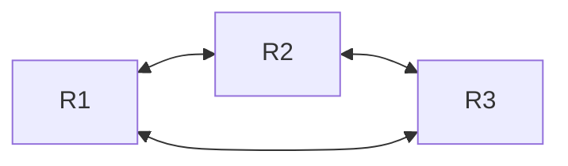
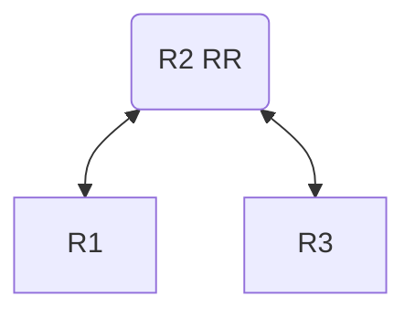

**eBGP** 會話的目的是在自治系統 (AS) 之間交換路由資訊。通常，eBGP 會話建立在網路出口點處直連的物理或邏輯網路（單跳鏈路）上，並且在預設引數下，如果對等體位於多跳之外，它將無法建立連線。  
在 EVPN 部署中，運營商通常會在由 IGP 路由的環回地址上執行 eBGP 會話。這意味著連線不再位於直連網路上，除非配置了 [`multihop`](../../../../cli-reference/routing/bgp/connection.md#multihop)`=yes`，否則將失敗。

AS_PATH 屬性用於防止路由環路。如果列表包含自身的 AS 號 (ASN)，該路由將被丟棄；但在某些特定部署中，這並不是期望的行為。例如，MPLS L3VPN 部署需要使用 [`input.allow-as`](../../../../cli-reference/routing/bgp/connection.md#input.allow-as) 引數覆蓋預設的環路預防機制，以允許 CE 路由器接受來自多歸屬或互連站點、且包含自身 ASN 的路由。

預設情況下，下一跳會因顯而易見的原因改為自身，但同樣，在某些部署中（例如 EVPN 疊加網路）這種行為並不可取。要覆蓋預設行為，請將 [`nexthop-choice`](../../../../cli-reference/routing/bgp/connection.md#nexthop-choice) 引數設定為 `propagate`。

## 內部 BGP (iBGP) 對等 {#internal-bgp-ibgp-peering}

與 **eBGP** 相反，**iBGP** 用於在自治系統內部交換路由資訊。它會將從 eBGP 對等體學習到的外部路由傳播到內部網路。

預設情況下，**iBGP** 會話被視為多跳，並執行在內部閘道器協定 (IGP)（如 [OSPF](../ospf/areas-and-virtual-links.md) 或 ISIS）之上，該協定提供環回地址之間的可達性。外部路由的下一跳會被傳播，而 IGP 負責下一跳解析。在較小的部署中，為了降低配置複雜性，可以透過將 [`nexthop-choice`](../../../../cli-reference/routing/bgp/connection.md#nexthop-choice) 引數設定為 `force-self` 並在直連網路上執行 iBGP 會話，來在不依賴底層 IGP 的情況下使用 iBGP。

當路由在 iBGP 對等體之間傳播時，不會將自身的 AS 號新增到 AS Path 列表中；相反，會使用水平分割進行環路保護，這規定從某個 iBGP 對等體學習到的路由不會通告給另一個 iBGP 對等體。為了克服水平分割的限制，每臺 iBGP 路由器都必須連線到其他所有 iBGP 路由器，從而形成**全互聯**。



全互聯的問題在於可擴充套件性，其連線總數為 `n*(n-1)/2`。為了簡化大規模 iBGP 網路，可使用[路由反射器 (RR)](#dynamic-sessions) 來消除對全互聯的需求。它建立用戶端–伺服器關係，其中用戶端僅與路由反射器建立對等關係，從而將連線數減少到 `n-1`。



引入 RR 會打破標準的水平分割規則以啟用路由反射，這就是使用 **ORIGINATOR_ID** 和 **CLUSTER_LIST** 屬性來防止路由環路的原因。

## 會話配置 {#session-configuration}

[`/routing/bgp/connection`](../../../../cli-reference/routing/bgp/connection.md) 選單定義 BGP 出站連線，同時也充當入站 BGP 連線的模板匹配器。

下面是一個非常基礎的 BGP 配置示例。假設 Router1 的 IP 為 192.168.1.1，AS 為 65531；Router2 的 IP 為 192.168.1.2，AS 為 65532：

```ros
#Router1
/routing/bgp/instance
add name=myInstance as=65531

/routing/bgp/connection
add name=toR2 remote.address=192.168.1.2 instance=myInstance local.role=ebgp
```

```ros
#Router2
/routing/bgp/instance
add name=myInstance as=65532

/routing/bgp/connection
add name=toR1 remote.address=192.168.1.1 instance=myInstance local.role=ebgp
```

[`local.role`](../../../../cli-reference/routing/bgp/connection.md#local.role) 是必選引數，用於描述會話的性質：它是 **eBGP** 會話（如我們的示例）、[**iBGP**](#internal-bgp-ibgp-peering) 會話，還是將充當 iBGP **route-reflector**。此外，還有其他模式用於 [RFC 9234](https://datatracker.ietf.org/doc/rfc9234/) 中的**路由洩漏預防和檢測**。

該連線不需要指定遠端 AS 號；RouterOS 會從收到的第一條 **OPEN** 訊息中動態確定它。

與其他廠商以及舊版 RouterOS 的 `update-source` 等效的引數是 [`local.address`](../../../../cli-reference/routing/bgp/connection.md#local.address)。在大多數情況下，可以不對其進行配置，路由器將自行確定地址。

當未指定本地地址時，BGP 將根據當前部署嘗試猜測它：

- 如果對等體是 iBGP
  - 如果存在環回地址
    - 選擇最高的環回地址
  - 如果不存在環回地址
    - 選擇路由器上最高的 IP 地址
- 如果對等體是 eBGP
  - 如果遠端對等體的 IP 不在直連網路中：
    - 如果未設定 multihop，BGP 會丟擲錯誤
    - 如果啟用了 multihop：
      - 如果存在環回地址
        - 選擇最高的環回地址
      - 如果不存在環回地址
        - 選擇路由器上最高的 IP 地址
  - 如果遠端對等體的 IP 在直連網路中：
    - 如果未設定 multihop：
      - 從該直連網路中選擇路由器的 IP 地址
    - 如果設定了 multihop：
      - 如果存在環回地址
        - 選擇最高的環回地址
      - 如果不存在環回地址
        - 選擇路由器上最高的 IP 地址

該選單還直接提供模板特定的引數，這在不需要模板的簡單場景中使配置更加容易。

:::warning
在不安全的環境中不應啟用對子網的監聽；此類配置可能導致拒絕服務 (DoS)。  
必須配置防火牆以保護路由器。  
有關更多詳細資訊，請參閱 [`listen`](../../../../cli-reference/routing/bgp/connection.md#listen) 引數。
:::

### 活動會話列表 {#active-session-list}

檢查 [`/routing/bgp/session`](../../../../cli-reference/routing/bgp/session/index.md) 選單以檢視會話是否已建立：

```ros
[admin@MikroTik] /routing/bgp/session> print 
Flags: E - established 
 0 E name="toR2" instance=myInstance 
     remote.address=192.168.1.2 .as=65532 .id=192.168.1.1 .refused-cap-opt=no 
     .capabilities=mp,rr,as4 .afi=ip,ipv6 .messages=43346 .bytes=3635916 .eor="" 
     local.address=192.168.1.1 .as=65531 .id=192.168.44.2 .capabilities=mp,rr,gr,as4 .messages=2 
     .bytes=71 .eor="" 
     output.procid=97 .keep-sent-attributes=no 
     .last-notification=ffffffffffffffffffffffffffffffff0015030601 
     input.procid=97 .limit-process-routes=500000 ebgp limit-exceeded 
     hold-time=3m keepalive-time=1m uptime=4s70ms
```

它顯示只讀的快取 BGP 會話資訊：當前狀態、標誌、最後收到的通知以及協商的會話引數。

即使 BGP 會話不再活動，快取仍可能保留一段時間。只有在快取過期時，才會移除從特定會話接收到的路由，這有助於在 BGP 會話反覆振盪時減輕大規模路由表重新計算。

如果 BGP 首次嘗試建立會話，而 TCP 連線因 MD5 認證錯誤、防火牆阻止或任何其他阻止連線的原因而無法發起，則不會建立會話條目。

### 引數分組 {#parameter-grouping}

您可能已經注意到，大多數引數都分組在 `output`、`input`、`local` 和 `remote` 部分中，這使配置更具可讀性，也更容易理解該選項是應用於 `input` 還是 `output`，或者它影響路由器本地的值，還是嘗試匹配遠端對等體的引數。  
例如：

- 要指定輸出選擇鏈，請設定 [`output.filter-chain`](../../../../cli-reference/routing/bgp/connection.md#output.filter-chain)`=myBgpChain`。
- 會話列表中的 `local.bytes` 表示已傳送多少位元組。
- `remote.messages` 表示遠端對等體已傳送多少封包。
- 依此類推。

### BGP 未編號 {#bgp-unnumbered}

RouterOS 能夠動態建立 BGP 會話，而無需在介面上配置全域性 IPv6 地址，也無需指定遠端鏈路本地地址（BGP 未編號連線）。該機制依賴 IPv6 鄰居發現 ([RFC 4861](https://datatracker.ietf.org/doc/html/rfc4861)) 來獲取鄰居的鏈路本地地址，並依賴 [RFC5549](https://datatracker.ietf.org/doc/html/rfc5549) 來通告帶有 IPv6 下一跳的 IPv4 NLRI。

如果 [`remote.address`](../../../../cli-reference/routing/bgp/connection.md#remote.address) 為空且 [`local.address`](../../../../cli-reference/routing/bgp/connection.md#local.address) 是介面，則配置為未編號連線。在此模式下，每個介面只接受一個連線。
它在包含大量點對點鏈路的部署中很有用，例如，當 eBGP 用作 EVPN 底層時。

對於未配置全域性地址、無法傳送 RA 回覆的路由器，請應用以下 ND 配置：

```ros
/ipv6/nd/prefix/add prefix=none interface=sfp-sfpplus1
```

```ros
[admin@CCR2004_2XS_111] /ipv6/neighbor> print 
Flags: D - DYNAMIC; R - ROUTER
Columns: ADDRESS, MAC-ADDRESS, INTERFACE, VRF
#    ADDRESS                    MAC-ADDRESS        INTERFACE     VRF 
0 DR fe80::de2c:6eff:fec5:a7ff  DC:2C:6E:C5:A7:FF  sfp-sfpplus1  main
```

新增未編號連線配置：

```ros
/routing bgp connection
add instance=myInstance local.address=sfp-sfpplus1 .role=ibgp name=unnumbered_2
```

```ros
[admin@CCR2004_2XS_111] /routing/bgp/connection> print 
Flags: D - DYNAMIC, X - DISABLED, I - INACTIVE 
 0   name="unnumbered_2" instance=myInstance 
     local.address=sfp-sfpplus1 .default-address=fe80::de2c:6eff:fea4:b42f%sfp-sfpplus1 .role=ibgp 
     routing-table=main as=333 

[admin@CCR2004_2XS_111] /routing/bgp/session> print 
Flags: E - ESTABLISHED 
 0 E name="unnumbered_2-1" instance=v6_test 
     remote.address=fe80::de2c:6eff:fec5:a7ff%sfp-sfpplus1 .as=333 .id=203.0.113.2 .capabilities=mp,rr,enhe,gr,as4 .afi=ipv6 
     .messages=5181 .bytes=98439 .eor="" 
     local.role=ibgp .address=fe80::de2c:6eff:fea4:b42f%sfp-sfpplus1 .as=333 .id=203.0.113.1 .cluster-id=203.0.113.1 
     .capabilities=mp,rr,enhe,gr,as4 .afi=ipv6 .messages=5181 .bytes=98439 .eor="" 
     output.procid=20 
     input.procid=20 ibgp 
     multihop=yes hold-time=3m keepalive-time=1m uptime=3d14h20m55s640ms last-started=2026-02-12 18:26:59 prefix-count=0 
```

### 動態會話 {#dynamic-sessions}

BGP 對等體配置可能相當複雜且可擴充套件性不強；例如，中心輻射型部署或 iBGP 路由反射器部署。

假設我們有一個連線了兩個對等體的路由反射器部署。為了簡化配置並使其可擴充套件，我們將利用 BGP 模板來設定公共引數，並配置連線監聽環回地址範圍，這樣我們就可以在路由反射器上不做任何配置的情況下新增更多對等體。


**先決條件**

- 介面上的 IP 連通性
- 在介面上配置並執行 OSPF

**路由反射器**

在配置 BGP 之前，我們需要新增環回地址並啟用 OSPF 來分發環迴路由：

```routeros
/ip address
add address=203.0.255.1 interface=lo
/routing ospf interface-template add interfaces=lo area=backbone passive
```

接下來建立一個包含公共引數的 BGP 模板，以及一個監聽環回地址範圍 (203.0.255.0/24) 的 BGP 會話：

```routeros
/routing bgp instance
add as=65000 name=bgp_inst
/routing bgp template
set default afi=ip multihop=yes nexthop-choice=propagate hold-time=10s
/routing bgp connection
add instance=bgp_inst local.address=203.0.255.1 .role=ibgp-rr name=rr remote.address=\
    203.0.255.0/24 templates=default listen=yes
```

要新增新的 BGP 對等體，請在對等體與路由反射器之間建立 IP 連線，並配置 BGP 連線到反射器的環回地址：

**Peer_1**

```routeros
/ip address
add address=203.0.255.11 interface=lo
/routing ospf interface-template add interfaces=lo area=backbone passive

/routing bgp instance
add as=65000 name=bgp_inst
/routing bgp connection
add instance=bgp_inst local.role=ibgp name=to_rr remote.address=203.0.255.1
```

**Peer_2**

```routeros
/ip address
add address=203.0.255.12 interface=lo
/routing ospf interface-template add interfaces=lo area=backbone passive

/routing bgp instance
add as=65000 name=bgp_inst
/routing bgp connection
add instance=bgp_inst local.role=ibgp name=to_rr remote.address=203.0.255.1
```

**Peer_N**

```routeros
/ip address
add address=203.0.255.1N interface=lo
/routing ospf interface-template add interfaces=lo area=backbone passive

/routing bgp instance
add as=65000 name=bgp_inst
/routing bgp connection
add instance=bgp_inst local.role=ibgp name=to_rr remote.address=203.0.255.1
```

有關更多用例，請參閱 EVPN，其中此方法用於 [EVPN 疊加網路](../evpn.md#bgp-evpn-overlay) 部署。
